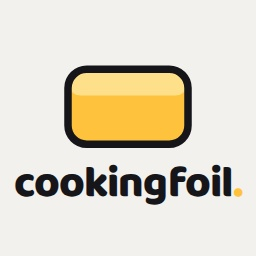
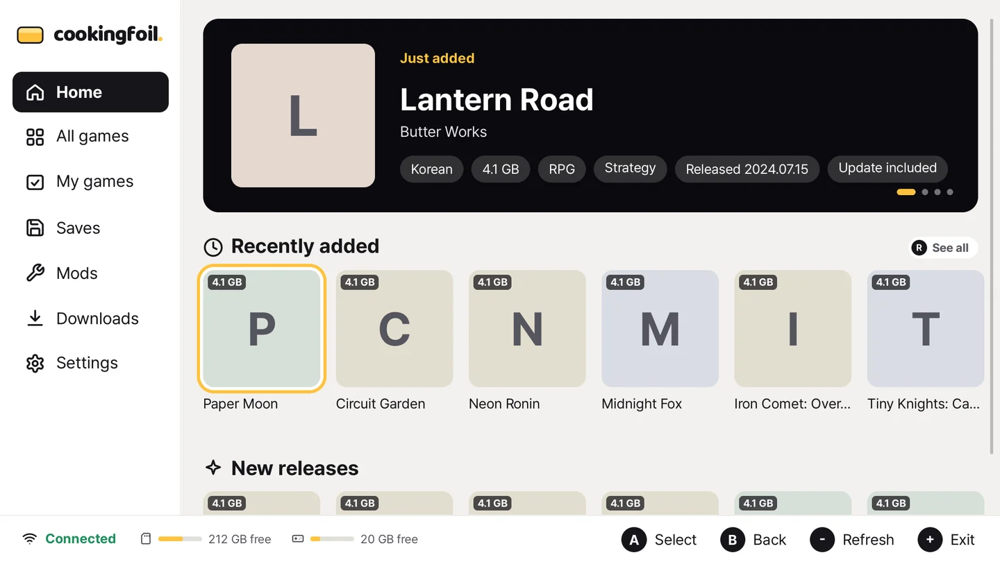

<div align="center">
  <h1></h1>
  <p><strong>ファイルは自分のサーバーへ。管理は本体から。</strong></p>
</div>

[English](README.md) | [한국어](README.ko.md) | **日本語** | [简体中文](README.zh-CN.md)

[](https://github.com/jshsakura/oc-cookingfoil/actions/workflows/ci.yml)
[](https://github.com/jshsakura/oc-cookingfoil/pkgs/container/oc-cookingfoil)
[](./LICENSE)

Switch の自作ソフト向けの、個人用でセルフホストのライブラリサーバーです。ファイルは自宅のマシンに置き、1 つの管理ページですべてを管理し、本体の CookingFoil クライアントからインストールします。

<p align="center">
  <a href="https://jshsakura.github.io/oc-cookingfoil/?lang=ja"></a>
  <a href="README.ja.md#クイックスタート"></a>
  <a href="README.ja.md#クライアントの接続"></a>
</p>



サンプルデータで動かした実際の英語 UI です。アイコンがない項目にはアプリ本来の頭文字タイルが表示されます。

## 目次

- [概要](#概要)
- [機能](#機能)
- [クイックスタート](#クイックスタート)
- [フォルダー構成](#フォルダー構成)
- [設定](#設定)
- [管理ページ](#管理ページ)
- [クライアントの接続](#クライアントの接続)
- [リバースプロキシと HTTPS](#リバースプロキシと-https)
- [任意の直接ダウンロードアドレス](#任意の直接ダウンロードアドレス)
- [セキュリティ](#セキュリティ)
- [API](#api)
- [FAQ とトラブルシューティング](#faq-とトラブルシューティング)
- [開発](#開発)
- [法的事項](#法的事項)
- [ライセンスとクレジット](#ライセンスとクレジット)

## 概要

CookingFoil は自分のサーバー上の Docker で動きます。入れたファイルの名前とアイコンを調べ、その一覧を本体のクライアントに配信します。

- **すべてを 1 つの管理ページで。** 設定、アカウント、本体、アップロード、自作ソフト、パッチ、セーブ、名前はブラウザーで変更します。変更はすぐに反映され、再起動も手でのファイル編集も要りません。
- **何も同梱していません。** ゲーム、キー、ファームウェア、BIOS ファイル、RetroArch は含まれていません。それらのフォルダーは空の状態で始まり、正当に所有するファイルを入れるまで、関係する機能はオフのままです。
- **最初から非公開です。** 初回セットアップにはサーバーログに出るコードが必要です。本体は QR 承認か、サーバーの Web 画面からダウンロードしたクライアントでその本体だけのアクセスキーを受け取って接続するので、アカウントのパスワードが本体に残ることはありません。本体はパスワードを継続的な接続には使いません。ID とパスワードは、ペアリングのときに 1 回だけ、本体を自動で承認するために使えます。

| プロジェクト | 動く場所 | 配布物 |
|---|---|---|
| CookingFoil サーバー (このリポジトリ) | Docker ホスト | `ghcr.io/jshsakura/oc-cookingfoil` (linux/amd64, linux/arm64) |
| CookingFoil クライアント | 本体の自作アプリメニュー | 各サーバーが自分で配ります。Web 画面のクライアントのダウンロードカード |

CookingFoil クライアントは GitHub では公開していません。サーバーの `data/client/` にクライアントのビルドがあれば (そのフォルダーに置くか、管理ページのアップロード (업로드) タブで「クライアント」としてアップロードします)、そのサーバーにサインインしたユーザーが Web 画面からダウンロードします。管理ページでクライアントのビルドの取得元を `github` にすると、クライアントのリポジトリ (`jshsakura/oc-cookingfoil-client`) の最新リリースにも従い、バージョンの高いほうのビルドを配ります。

Web ページ、初回セットアップ、サインイン、本体承認のページは英語、韓国語、日本語、簡体字中国語に対応し、ライトとダークのテーマを選べます。管理ページでは 12 言語を選択できます。残りの運用メッセージは翻訳中です。運用ガイド (`/admin/guide`) は現在韓国語です。

## 機能

- **ライブラリ一覧。** CookingFoil クライアントと Web 画面向けのセクション分けされた一覧を提供します。おすすめの列は管理ページで並べられます。自動化トークンを持つスクリプト向けに、ファイルの一覧 (`/games.json`) もあります。
- **名前とアイコン。** タイトル、説明、アートワークは [blawar/titledb](https://github.com/blawar/titledb) から取得し、titledb にないファイルはファイル自体から (自分の `prod.keys` を使って) 読み取ります。名前の言語の優先順位と地域は設定で変えられます。
- **アートワークと評価。** アイコンはゲームファイルから直接読み（ご自身の `prod.keys` を使用）、バナーはそのアイコンから描きます。ストアから画像は取得しません。Steam のレビュースコア、IGDB スコアも任意で使えます。どの取得元もオフにでき、自分のアートワークをアップロードすることもできます。
- **GitHub からの自作ソフト。** リポジトリを登録すると最新リリース (`.nro`、または中に `.nro` を含む zip) を追いかけます。手で置いたアプリも扱えます。アプリはツールか移植版に分けられ、オフにでき、HOME メニューのショートカットも用意できます。
- **セーブとパッチ。** セーブファイルとパッチ (SD カードのルートと同じ構成) をサーバーに置いておき、どれを入れるかをクライアントで選びます。パッチは必須に指定でき、対応するゲームの更新バージョンを記録できます。
- **RetroArch 向けレトロゲーム。** システムごとの ROM、libretro-thumbnails のボックスアート、The Bezel Project のベゼル、LaunchBox Games Database のゲーム情報 (説明、パブリッシャー、開発元、発売日、人数、ジャンル、スクリーンショット) を扱い、足りない分は IGDB で補います。1 つのゲームの複数の版 (アーケードの親セットとクローンセット、複数の言語や地域の版) は 1 枚のカードにまとまり、ほかの版はもう 1 回押すと出ます。自分で用意した RetroArch ベースパックを本体に配ることができ、ゲームごとに HOME メニューのショートカットも作れます。
- **本体ごとに自分のキーで接続。** CookingFoil クライアントが表示する QR をスマートフォンで承認するか、Web 画面からダウンロードしたクライアントがそのまま接続します。どちらでも本体は自分専用のアクセスキーを受け取り、パスワードは保存されません。
- **アカウントと Google サインイン。** 管理者とユーザーの役割を持つ ID とパスワードのアカウントと、任意の Google サインインに対応します。新しい Google アカウントは承認待ちになります。
- **2 要素目のある管理ページ。** 管理ページは認証アプリ (TOTP) のコードか、別の管理者パスワードをもう一度求めます。自動化トークンを使えば、スクリプトから同じ API を使えます。
- **一時共有の受け箱。** サインインしたユーザーは、運営者が後で整理するためのファイル、メモ、リンクを残せます。
- **Telegram 通知。** 本体とアカウントの承認依頼 (承認と拒否のボタン付き)、ロックアウト、ブロックした攻撃の試み、一時共有へのアップロード、サーバーの起動を知らせます。
- **途切れないダウンロード。** 再起動のときは新しいリクエストに `503` と `Retry-After` で応答し、実行中のダウンロードが終わるのを先に待ちます。任意の直接ダウンロードアドレスはダウンロード専用で、サインインの代わりに短時間だけ有効なダウンロードトークンで開きます。

## クイックスタート

Docker と Compose v2(`docker compose`、2.9 以降)が必要です。イメージは amd64 と arm64 で動きます。Synology NAS では下の [Synology NAS](#synology-nas) に従います。

```bash
mkdir cookingfoil && cd cookingfoil
curl -O https://raw.githubusercontent.com/jshsakura/oc-cookingfoil/main/docker-compose.yml
curl -o .env https://raw.githubusercontent.com/jshsakura/oc-cookingfoil/main/.env.example
sed -i "s|^COOK_SECRET_KEY=.*|COOK_SECRET_KEY=$(openssl rand -base64 32)|" .env
docker compose up -d
docker compose logs cookingfoil | grep "setup code"
```

1. `http://<host>:9080/` を開きます。初回セットアップが表示されます。
2. ログに出たセットアップコードを入力します。コードは起動するたびに変わるので、ログを見られない人がサーバーを乗っ取ることはできません。
3. 管理者アカウントを作り、認証アプリを登録します。
4. 管理ページが開きます。ほかのことはすべてそこで行います。

クライアントには、ブラウザーで開いたのと同じアドレスを入れます。更新するときは `docker compose pull && docker compose up -d` を実行します。

compose ファイルの要点です ([完全なファイル](./docker-compose.yml) には各行にコメントがあります)。

```yaml
services:
  cookingfoil:
    image: ghcr.io/jshsakura/oc-cookingfoil:latest
    restart: unless-stopped
    stop_grace_period: 40s
    env_file:
      - .env
    environment:
      PUID: ${PUID:-1000}
      PGID: ${PGID:-1000}
    ports:
      - "9080:80"
    volumes:
      - ./storage:/storage
```

### Synology NAS

1. パッケージセンターから **Container Manager** をインストールします(DSM 7.2 以降)。
2. File Station で `docker/cookingfoil` などのフォルダーを作り、`docker-compose.yml` と `.env`(`.env.example` のコピー)を置きます。`.env` の `COOK_SECRET_KEY` には、どのパソコンでもよいので `openssl rand -base64 32` で作ったキーを入れます。
3. `.env` の `PUID` と `PGID` を、フォルダーの持ち主のアカウントに合わせます。SSH で `id <アカウント>` を実行すると分かります。最初の管理者アカウントはたいてい `1026`、`users` グループは `100` です。
4. すべてを既存の共有フォルダーに置くには `COOK_STORAGE_PATH=/volume1/cookingfoil` のようにパスを設定し、そのアカウントに読み書き権限を与えます。
5. Container Manager で **プロジェクト**、**作成** の順に選び、手順 2 のフォルダーを選んで中の `docker-compose.yml` をそのまま使います。ウィザードを最後まで進めます。
6. セットアップコードは **コンテナ**、`cookingfoil`、**ログ** にあります。`http://<NAS のアドレス>:9080/` を開きます。DSM のファイアウォールを有効にしているなら 9080 番ポートを許可します。

## フォルダー構成

```
cookingfoil/
├── docker-compose.yml
├── .env              # optional; defaults for the first start
└── storage/          # the one folder mounted at /storage; the server makes the rest
    ├── incoming/     # drop box: files put here are sorted into the folders below
    ├── games/        # sorted Switch games, one folder per game with update/ and DLC/
    ├── homebrew/     # .nro apps, app folders, or a release zip left in its own folder
    ├── retro/        # retro ROMs, art and the RetroArch base pack
    ├── patches/      # patches by base title id, and homebrew/<app>/
    ├── saves/        # save files by title id, and homebrew/<app>/
    ├── keys/         # recommended: your own prod.keys (or upload it on the admin page)
    └── data/         # cache, accounts and every setting saved on the admin page. Back this one up
```

保存フォルダーは、`.env` の `COOK_STORAGE_PATH` で変えない限り `docker-compose.yml` の隣の `./storage` です。サーバーは起動時にその中へ上のフォルダーを作ります。`COOK_<名前>_DIR` でそのうち一つを別の場所に置くこともできます。

整理を任せるには、ファイルを `storage/incoming/` に入れます。1 分間変わらなかったファイルから、ファイルの中の情報(`prod.keys` がなければ名前やチケット)でタイトル ID とバージョンを読み、ファイル名を `ゲーム名 [TITLEID][vN].拡張子` に変えて、`games/` の中にゲームごとのフォルダーを一つ作り、本編の隣に `update/` と `DLC/` を置いて移します。ゲーム名は管理ページで決めた名前、titledb、ファイル内の NACP(`prod.keys` と nstool があれば NSP、NSZ、XCI、XCZ から読みます)、配布元の表示やタグ、ブラウザーが付けた ` (1)` を外した元のファイル名の順に選び、文字化けした名前は飛ばします。一緒に届いた本編とアップデートは同じ名前を使います。フォルダーがすでにあるゲームはそのフォルダーを使い、新しいゲームはその名前でフォルダーを作ります。titledb にないゲームは本編かアップデートの NACP の名前で、それもなければ本編のファイル名でフォルダーを作ります。DLC だけが届いたときは、そのゲームのフォルダーがあるか、titledb か管理ページがゲーム名を知っていれば移し、そうでなければ本編かアップデートが来るまで残して管理ページにそう表示します。ファイル名に意味のない DLC(`dlc2` など)は `ゲーム名 DLC n` と名付けます。レトロ ROM は機種名のフォルダー(`incoming/snes/`)に入れると `retro/` へ、単独の `.nro` は `homebrew/` へ移ります。上書きはせず、移せなかったファイルは `incoming/` に残り、管理ページ(ライブラリー、一時フォルダー)に理由が出ます。サーバーは一時フォルダーを名前や中身ではなく場所で見分けるので、`games/` の中のフォルダーを整理対象と取り違えることはありません。

**別々にマウントしていたサーバーを移すとき。** 新しく設置すると保存フォルダーだけをマウントします。ファイルがまだ別々のフォルダー(`./games`、`./data`、`./keys` など、または `COOK_<名前>_PATH` で決めた場所)にあるサーバーは `docker-compose.legacy.yml` を一緒に使います。`docker compose -f docker-compose.yml -f docker-compose.legacy.yml up -d` で起動するか、`.env` に `COMPOSE_FILE=docker-compose.yml:docker-compose.legacy.yml` を入れます。このファイルなしで起動するとそれらのフォルダーはマウントされず、サーバーは空の状態で起動します。ディスク上のファイルには触れません。一緒に使うと、ファイルのある古いフォルダーはそのまま使い、管理ページの概要で知らせます。空のフォルダーは無視します。移行を終えるには、サーバーを止め、各フォルダーの中身を上の名前で保存フォルダーの中へ移し、legacy ファイルを外してから起動します。移す途中で上書きはしません。`games/incoming/` にあったものは、同じ名前がなく別のディスクでもなければ `incoming/` へ移します。残ったものは概要に出ます。

サーバーはユーザー `PUID`、グループ `PGID` で動きます(`.env` になければ 1000、1000)。そのため、これらのフォルダーにサーバーが書いたファイルは自分のものになります。自分の値はホストで `id` を実行すると分かります。起動時にデータフォルダーをそのユーザーに渡し、書き込めないライブラリーフォルダーは直すコマンドと一緒にログに出します。それ以外は変えません。`PUID=0` なら root で動き、compose ファイルに `user:` を書けばそのユーザーのまま動きます。

`retro/` の中身です。

```
retro/
├── roms/<system>/<game file>                          # a game, or a subfolder holding one
├── thumbnails/<system>/Named_Boxarts/<game name>.png  # box art (fetched, or your own)
├── bezels/<system>/<game name>.png                    # bezels (fetched, or your own)
├── screenshots/                                       # game screenshots (fetched)
├── retroarch/                                         # your RetroArch base pack (optional)
├── systems.json                                       # optional overrides of folder and libretro names
└── arcade-names.json                                  # optional arcade display names
```

システムごとに、短い ID の名前を付けたフォルダーを 1 つ使います: `nes` `snes` `gb` `gbc` `gba` `n64` `nds` `md` `sms` `gg` `segacd` `saturn` `pce` `pcecd` `ps1` `psp` `ngp` `ws` `arcade` `neocd`。アーケードのゲームは FinalBurn Neo のセット名 (たとえば `mslug.zip`) のまま使います。ボックスアートはファイル名に含まれる英語タイトルで照合するので、`My Title (English Title)` のような名前がいちばんうまくいきます。

RetroArch ベースパックは、本体が遊ぶ前に一度だけ必要になるものです。`retroarch.nro`、`retroarch.cfg`、RetroArch が使うフォルダー (`cores/`、`assets/`、`system/` など) を `retro/retroarch/` に置きます。ゲームのあるシステムで足りない BIOS ファイルは管理ページが教えてくれます。CookingFoil が BIOS を配布することはありません。

## 設定

ほとんどの設定は管理ページで変更し、すぐに反映されます。`.env` の値は初回起動時の既定値にすぎません。管理ページで設定を変えるとページの値が優先され、「compose の値に戻す (compose 값으로)」操作で `.env` の値に戻ります。すべての変数とその説明は [`.env.example`](./.env.example) にあります。

次の変数は管理ページができる前に必要か、意図的に管理ページから外してあるものです。

| 変数 | 既定値 | 用途 |
|---|---|---|
| `COOK_SECRET_KEY` | _(必須)_ | データフォルダに置く秘密情報を暗号化します(AES-256-GCM)。`openssl rand -base64 32` で作り、大切に保管します。新しいキーでは古いキーで封じた値を開けません |
| `COOK_HOST_PORT` | `9080` | ホスト側のポート |
| `PUID` / `PGID` | `1000` / `1000` | サーバーが動くユーザーとグループ。サーバーが書いたファイルが自分のものになります。`0` なら root で動きます |
| `COOK_TRUST_PROXY` | _(空)_ | クライアントのアドレスを設定してよいプロキシのホップ。例: `loopback, uniquelocal` |
| `COOK_FIRST_RUN_SETUP` | `true` | `false` にすると、アカウントのないサーバーでもブラウザーを `/setup` に送らず開いたままにします |
| `COOK_AUTH_USERS` | _(空)_ | `/setup` の代わりに用意するアカウント。`user:pass,user2:pass2`。最初のアカウントが管理者で、残りは一般ユーザーです |
| `COOK_ADMIN_PASSWORD` | _(空)_ | 管理者パスワードと認証アプリの両方をなくしたときの入口 (12 文字以上) |
| `COOK_ADMIN_TOTP_SECRET` | _(空)_ | `/setup` を使わず、認証アプリのシークレットを自分で管理します |
| `COOK_DIRECT_EDGE_SECRET` | _(空)_ | 直接ダウンロード用プロキシとの共有シークレット。[後述](#任意の直接ダウンロードアドレス)を参照してください |
| `COOK_DIRECT_COUNTRIES` | _(空)_ | 直接ダウンロード用アドレスを使える国の ISO コードです (`KR,JP`)。Cloudflare が別の国と判定したクライアントは通常の URL を使います。空なら国を問いません |
| `COOK_RATE_LIMIT_PER_MIN`, `COOK_RATE_LIMIT_BURST` | `1200`, `300` | 1 つのアドレスが 1 分間に送れるリクエスト数と、一度に送れる数 |
| `COOK_AUTH_MAX_FAILURES`, `COOK_LOCKOUT_TTL_HOURS` | `5`, `0` | アドレスをロックするまでのサインイン失敗回数と、ロックの長さ (`0` なら管理者が解除するまで) |
| `COOK_ADMIN_SESSION_HOURS` | `8` | 管理ページのサインインが続く時間 |
| `COOK_OUTBOUND_PRIVATE_HOSTS` | _(空)_ | プライベート、ループバック、CGNAT のアドレスに解決されてもサーバーが取得してよいホスト名です。たとえば tailnet 内の titledb ミラーです。管理ページで設定したそれ以外のアドレスが内部ネットワークを指す場合は拒否します |

ふだんは管理ページ (設定 (설정) タブ) で変える設定です。どれも `.env` で既定値を入れておけます。

| 設定 | 変数 | 既定値 |
|---|---|---|
| QR による本体接続 (Web 画面のクライアントのダウンロードにも必要です) | `COOK_DEVICE_PAIRING` | `true` |
| 本体の承認方法 | `COOK_DEVICE_AUTO_APPROVE` | `true`: ペアリングのときに ID とパスワードを 1 回送った本体はすぐ承認します。`false`: 管理者が 1 台ずつ承認します。`all`: 求めてきた本体をすべて承認します |
| アカウントごとの本体数 | `COOK_DEVICE_LIMIT` | 1 つのアカウントが持てる承認済み本体の数です。承認の方法にかかわらず数えます。既定は `10`、`0` は無制限。設定タブで変更できます |
| ダウンロードで 1 時間に接続する本体数 | `COOK_ENROLL_PER_HOUR` | 1 つのアカウントがダウンロードしたクライアントで、1 時間以内に自動で接続できる異なる本体の数です。そのアカウントのすべてのダウンロードを合わせて数えます。既定は `5`、1 から 50 まで。設定タブで変更できます |
| 公開アドレス | `COOK_PUBLIC_BASE_URL` | リクエストごとに導出 |
| Web アップロード | `COOK_UPLOADS_ENABLED` | `false` |
| 一時共有の受け箱 | `COOK_INBOX_ENABLED` | `true` |
| 名前の言語の優先順位 | `COOK_LANG_PRIORITY` | `ko,en,ja,en-US` |
| titledb のダウンロード、地域、取得元 | `COOK_TITLEDB_AUTO_FETCH`, `COOK_TITLEDB_REGIONS`, `COOK_TITLEDB_URL` | オン、組み込みのセット、blawar/titledb |
| クライアントのビルドの取得元 | `COOK_CLIENT_SOURCE`, `COOK_CLIENT_RELEASE_REPO`, `COOK_CLIENT_RELEASE_TAG` | `manual`: アップロードしたビルドだけを使います。`github` は `jshsakura/oc-cookingfoil-client` の最新リリース (タグを入れるとそのタグ) にも従います |
| ファイルから読むアイコン | `COOK_EXTRACT_ICONS` | `missing` |
| レビュースコア、レトロゲーム情報 | `COOK_RATING_SYNC`, `COOK_RETRO_META` | オン |
| レトロ機種フォルダの作成 | `COOK_RETRO_SCAFFOLD` | オン |
| 1 回のダウンロードの接続数 | `COOK_DOWNLOAD_MAX_CONNECTIONS` | `4` |
| 直接ダウンロードアドレス、トークンの有効期間 | `COOK_PUBLIC_DIRECT_BASE_URL`, `COOK_DOWNLOAD_LINK_TTL` | オフ、`21600` 秒 |
| 安全な再起動 | `COOK_RESTART_RETRY_AFTER`, `COOK_RESTART_GRACE` | `20` 秒、`25` 秒 |
| フォルダの同期、毎日のバックアップ | `COOK_SYNC_HOURS`, `COOK_BACKUP_DAYS` | `6` 時間ごと、`14` 日保存 (`0` で止めます) |

外部サービスのキー (IGDB、SteamGridDB、Dropbox、GitHub)、Google サインイン、Telegram 通知は管理ページで入力します。それぞれの取得先もそこに書いてあります。どれも任意で、ないときはそれを必要とする機能だけがオフになります。

## 管理ページ

`/admin` を開きます。サインインの後、認証アプリのコードか管理者パスワードをもう一度求めます (Google でサインインした管理者には求めません)。変更はすべて `data/` に保存され、すぐに反映されます。

| タブ | できること |
|---|---|
| 概要 (개요) | サーバーの状態、設定の警告、ゲーム名の取得元 |
| ユーザー (사용자) | アカウントと役割、承認待ちの Google アカウント |
| 本体 (기기) | 本体の承認と拒否、名前の変更と切断、本体 1 台用のログイン作成 |
| 設定 (설정) | サーバーの動作 (本体の承認、アップロード、公開アドレス、歓迎メッセージ、名前と地域、ストアのデータ、評価、ダウンロード、安全な再起動)、外部サービスのキー、Google サインイン、管理者パスワード、認証アプリ、自動化トークン |
| 通知 (알림) | Telegram 通知と、その対象のイベント |
| ログ (로그) | ロックされたアドレス、理由付きの拒否されたリクエスト、クライアントのエラー報告 |
| おすすめ (추천) | クライアントのホーム画面の上部に並ぶ列 |
| ライブラリ (라이브러리) | ファイルの検索と削除、パッチとセーブの編集、移動、削除、必須パッチの指定、ゲームの名前、説明、メモの設定 |
| アップロード (업로드) | ゲーム、レトロ ROM、パッチ、セーブ、自作ソフトをファイル単位かフォルダー単位で |
| 一時共有 (임시 공유) | サインインしたユーザーが残したファイル、メモ、リンク |
| 自作ソフト (홈브류) | GitHub リポジトリの追加、アプリのオンとオフ、削除、手で置いたアプリとリポジトリの関連付け |
| レトロ (레트로) | ボックスアートとベゼル、カバーのアップロード、表示名、バリエーション、ROM の削除 |

`/admin/guide` の運用ガイドは作業ごとの手順と、管理ページが使う API をまとめています。自動化トークンを持つスクリプトや AI アシスタントも同じ作業ができます。

## クライアントの接続

本体は CookingFoil クライアントで、次の 2 つのどちらかの方法で接続します。どちらも本体にその本体だけのアクセスキーを渡し、最初からオンです。本体はパスワードを継続的な接続には使いません。ID とパスワードは、ペアリングのときに 1 回だけ、本体を自動で承認するために使えます。

**1. CookingFoil クライアントを QR で接続。** 自作アプリのメニューからクライアントを開き、サーバーのアドレスを入力すると、QR コードと 8 文字の本体コードが出ます。スマートフォンで QR を読み取るか `/pair` で本体コードを入力し、サインインして承認します。本体は自分専用のアクセスキーを受け取ります。承認方法が「サインインした本体はすぐ承認」(既定) なら、クライアントに入れた ID とパスワードで代わりにすぐ承認されます。確認するのはそのときだけで、それ以降の本体はアクセスキーを使います。

**2. CookingFoil クライアントを Web 画面から取得。** サーバーの Web 画面にサインインし、クライアントのダウンロードカードを使います。`switch/cookingfoil/cookingfoil.nro` と、このサーバーのアドレスと登録トークンを入れた `config.json` の入った zip を受け取ります。`switch/` フォルダーを SD カードにコピーしてクライアントを開きます。最初の起動でクライアントがトークンを自分のアクセスキーに替え (`POST /api/pair/enroll`)、あなたのアカウントの下で承認されるので、読み取る必要はありません。ダウンロードから 1 時間以内なら本体 `COOK_ENROLL_PER_HOUR` 台まで (既定 5、設定タブで変更できます) 自動で接続され、それ以上は QR で承認します。この数はそのアカウントのすべてのダウンロードを合わせて 1 時間で数えるので、ダウンロードし直しても増えません。手動承認 (`COOK_DEVICE_AUTO_APPROVE=false`) では 1 回のダウンロードで本体 1 台だけです。新しくダウンロードすると同じアカウントの以前のダウンロードは終わり、接続済みの本体はそのまま残ります。トークンで接続できなかった本体は、サーバーのアドレスしか知らない本体と同じように承認を待ちます。ダウンロードは同じ画面か管理ページの本体 (기기) タブで取り下げられます。1 つのアカウントが持てる本体は、承認の方法にかかわらず `COOK_DEVICE_LIMIT` 台までです (既定 10、0 は無制限、設定タブで変更できます)。使うまでは zip を鍵と同じように扱ってください。

どちらの方法でも、クライアントはアクセスキーを 12 時間のセッショントークンに替え (`GET /api/session`)、以後はそのトークンだけを送ります。接続後はサーバーから自分自身を更新し、HOME メニューのショートカットも作れます。新しいデバイスキーに移る本体は、`POST /api/pair/rebind` で承認を引き継ぎます。

## リバースプロキシと HTTPS

CookingFoil はプレーンな HTTP で動きます。自宅の外から使うには、HTTPS を終端するリバースプロキシやトンネル (nginx、Caddy、Traefik、Cloudflare Tunnel など) の後ろに置きます。

そのまま使える Caddy (HTTPS を一つのスタックで)、nginx、Cloudflare Tunnel の設定ファイルは [`examples/`](examples/) にあります。

- `COOK_TRUST_PROXY` には、クライアントのアドレスを設定してよいホップだけを指定します。同じホストかプライベートネットワーク上のプロキシなら `loopback, uniquelocal` です。`true` はすべてのホップを信頼するので、プロキシを経由しないとサーバーに届かない構成でのみ安全です。この設定がないと、すべてのクライアントがプロキシの 1 つのアドレスに見えるため、見知らぬ 1 人のサインイン失敗で全員がロックされることがあります。この状態を検出すると管理ページが警告します。`X-Forwarded-Host` と `X-Forwarded-Proto` もこれらのホップから届いたものだけを信頼し、それ以外からの場合は接続自体の `Host` (設定していれば `COOK_PUBLIC_BASE_URL`) を使います。
- プロキシには `X-Forwarded-For`、`X-Forwarded-Proto`、`X-Forwarded-Host` を転送させます。ダウンロードとアートワークの URL は絶対 URL で、これらのヘッダーから組み立てます。プロキシが `Host` を書き換える場合は、管理ページで公開アドレスを設定します (または `COOK_PUBLIC_BASE_URL=https://library.example.org`)。
- 大きなレスポンスと長いリクエストを許可します。本体は多数の Range リクエストでダウンロードし、1 つのファイルが数十 GB になることもあります。
- CookingFoil の前に置いた開発サーバー (Vite など) は、知らない `Host` ヘッダーを `403` で拒否することがあります。プロキシを疑う前に `curl -H "Host: library.example.org" http://127.0.0.1:9080/` でオリジンを直接確かめてください。

## 任意の直接ダウンロードアドレス

構成によっては、ライブラリサーバーが経由するトンネルや CDN が非常に大きなファイルに対して遅かったり制限があったりします。直接ダウンロードアドレスを使うと、それを求めるクライアントはダウンロードだけを扱う 2 つ目の HTTPS アドレスから受け取り、一覧とサインインはメインのアドレスに残ります。

仕組みです。

1. コンテナと同じホスト上のリバースプロキシが、たとえば `https://dl.example.org` を提供します。このプロキシは `Authorization: Bearer …` を持つ `GET` と `HEAD` のリクエストだけを転送し、`X-Forwarded-For` を自分で設定し、`Host` を直接アドレス (ポートがあればポート付き) にし、`X-CookingFoil-Edge: <secret>` を付けます。メインのトンネルを通ってきたリクエストは転送してはいけません。
2. 同じシークレットを `.env` の `COOK_DIRECT_EDGE_SECRET` に入れます。これは管理ページの設定にはなりません。設定がないと、直接アドレスは何も返しません。
3. アドレスは管理ページ (設定 (설정) タブのダウンロード) か `COOK_PUBLIC_DIRECT_BASE_URL` に入れます。`https://` である必要があります。
4. HTTPS で `X-CookingFoil-Features: direct-token` を送るサインイン済みのクライアントは `X-CookingFoil-Download-Token` ヘッダーを受け取り、一覧のダウンロード URL が直接アドレスを指すようになります。一緒に届く `X-CookingFoil-Download-Origin` は直接アドレスの origin で、クライアントはそこにだけトークンを Bearer トークンとして送ります。

トークンはサーバーが署名し (`data/security/security.db` に暗号化して保存したランダムな鍵による HMAC-SHA256)、`COOK_DOWNLOAD_LINK_TTL` 秒 (既定は 6 時間) 有効で、発行対象のアカウントや本体がサインインできなくなった時点で使えなくなります。拒否のレスポンスには `X-CookingFoil-Token: invalid | expired | revoked | blocked` が付き、無効なトークンを送りすぎたアドレスはしばらく締め出されます。この機能を宣言しないクライアント (古いクライアントのビルド、ブラウザー) とプレーンな HTTP のリクエストには、これまでとまったく同じ一覧が返ります。Cloudflare 経由で届き、`CF-IPCountry` が `COOK_DIRECT_COUNTRIES` (設定したとき) に含まれないリクエストは、通常の URL のままです。

DNS 証明書と DDNS まで含む Caddy の完全な設定は [`examples/direct-download/`](examples/direct-download/) にあります。

最小限の nginx の例です (証明書、ポート、シークレットは環境に合わせてください)。

```nginx
server {
  listen 443 ssl;
  server_name dl.example.org;
  # ssl_certificate ...; ssl_certificate_key ...;

  location / {
    limit_except GET HEAD { deny all; }
    if ($http_authorization !~ "^Bearer ") { return 401; }
    proxy_set_header Host dl.example.org;
    proxy_set_header X-Forwarded-For $remote_addr;
    proxy_set_header X-Forwarded-Proto https;
    proxy_set_header X-Forwarded-Host "";
    proxy_set_header CF-Connecting-IP "";
    proxy_set_header X-CookingFoil-Edge "change-me-to-a-long-random-string";
    proxy_buffering off;
    proxy_pass http://127.0.0.1:9080;
  }
}
```

## セキュリティ

CookingFoil は、自分のプロキシの後ろでインターネットに置かれることを前提に作っています。そのためロックされた状態で始まり、オンにしたものだけを開きます。この節では、何を設定するか、入り口ごとに何を信頼するか、アクセスをどう取り消すかを説明します。

### おすすめの設定

1. **すべての本体を QR か Web 画面のクライアントのダウンロードで接続します。** どの本体も個別に取り消せる自分のキーを持ち、パスワードを持ち続ける本体はありません。
2. **管理ページの 2 要素認証を維持します。** セットアップのときに認証アプリを登録します。別の管理者パスワード (`COOK_ADMIN_PASSWORD`、12 文字以上) で代えることもできますが、どのサーバーアカウントのパスワードとも違うものにします。
3. **外からは HTTPS だけで入ります。** HTTPS を終端するリバースプロキシかトンネルを通してサーバーに届くようにし、平文 HTTP のポートはインターネットに公開しません。
4. **`COOK_TRUST_PROXY` にはプロキシの経路だけを入れ**、それより広くしません。[リバースプロキシと HTTPS](#リバースプロキシと-https) を参照してください。
5. **承認方法は理解して選びます。**「サインインした本体はすぐ承認」(既定) と「管理者が 1 台ずつ承認」が安全な選択です。「すべて承認」は自分の本体しか届かないサーバーでだけ使います。
6. **`data/` を守り、バックアップします。** アカウント、デバイスキー、署名キーがすべてここにあります。

### 入り口ごとに信頼するもの

| 誰か | 何で証明するか | できること |
|---|---|---|
| Web 画面のユーザー | アカウントの ID とパスワード、または Google サインイン (新しい Google アカウントは承認待ちになります) | 閲覧、自分の本体の承認、クライアントのダウンロード、一時共有、Web アップロードがオンならアップロード |
| 管理者 | 管理者ロールのアカウントと、認証アプリのコードまたは管理者パスワード | 管理ページのすべての操作。管理者セッションは `COOK_ADMIN_SESSION_HOURS` の間続きます |
| ペアリング済みの本体 | デバイスキーとアクセスキー、その後は同じデバイスキーに結び付いた 12 時間のセッショントークン。パスワードはペアリングのときに 1 回だけ数え、ほかでは数えません | 一覧の読み取りとダウンロード |
| 自動化トークン | `Authorization: Bearer cft_…` | `/admin/api/` の下の管理 API を、作成した管理者として使います。トークンの作成や取り消し、管理者のサインイン方法、機器の承認、通知、サインインとアドレスに関する設定の変更はできません |
| 直接ダウンロードアドレス | エッジシークレットを持つローカルのプロキシを通った、短時間だけ有効なダウンロードトークン | `GET` と `HEAD` のダウンロードだけ |

全員が見るもの (アートワーク、説明、ゲームフォルダーのファイル) の変更とアップロードの一覧は、管理者アカウントだけが扱えます。一般ユーザーのアカウントとペアリング済みの本体は読むだけです。

### ディスクに残すもの

- アカウントのパスワードは scrypt ハッシュだけを残します。
- 本体のアクセスキーと自動化トークンは SHA-256 ハッシュだけを残します。元の値は作成時に一度だけ表示します。
- サーバーが読み戻す必要のある秘密情報(管理者の認証アプリのシークレット、セッションとダウンロードトークンの署名キー、Google と IGDB のクライアントシークレット)は `COOK_SECRET_KEY` で AES-256-GCM 暗号化して保存します。キーはデータフォルダではなく `.env` にあるので、データフォルダだけをコピーしても何も開けません。
- `COOK_SECRET_KEY` は別に保管してください。キーがないとサーバーは起動せず、新しいキーでは古いキーで封じた値を開けません。
- アカウント、承認した本体、本体専用ログイン、トークン、保存した設定、監査ログ、暗号化した秘密の値は `data/security/security.db`（SQLite）に保存し、サーバーのアカウントだけが読めます(0600)。下の索引と違って作り直せないので、データフォルダと一緒にバックアップします。
- セーブ、自作アプリ、レトロのフォルダを読んだ一覧とファイルのハッシュは `data/cookingfoil.db`（SQLite）に保存します。そのため再起動してもすぐに一覧を出せます。フォルダの索引にすぎないので、消すとサーバーがフォルダを読み直します。
- ライブラリのすべてのフォルダを `COOK_SYNC_HOURS` 時間ごとに最初から読み直し、設定タブの **今すぐ同期** ですぐに読み直します。新しいファイルはフォルダの監視が届いたときに拾い、これは取りこぼしを埋めます。
- 1 日に 1 回、セキュリティのデータベースと手で管理するファイル (ダウンロード・通知の記録、NSZ の待ち行列、説明、手で直した名前、自作アプリの出どころ、アップロードした画像) を `data/backups/<日付>/` (0700) にコピーし、`COOK_BACKUP_DAYS` 日保存します。設定タブの **今すぐバックアップ** ですぐに作ります。ROM、画像、キャッシュは自然に戻るので入れません。ディスクの故障に備えるには `data/backups` を別のディスクにコピーします。

### 本体の承認方法

サインインしたユーザーによる QR の承認と、Web 画面からダウンロードしたクライアントは、承認方法にかかわらず常にそのユーザーのアカウントの下で本体を承認します。つまりアカウントを持つ人は誰でも本体を追加できるので、アカウントは信頼できる人にだけ渡してください。それ以外の本体は、設定 (설정) タブの承認方法で決まります。

- **管理者が 1 台ずつ承認。** 管理者が本体 (기기) タブか Telegram 通知の承認ボタンで承認するまで待ちます。
- **サインインした本体はすぐ承認** (既定)。ペアリングの要求とともにアカウントの ID とパスワードを送った本体は、その場で承認します。パスワードを確認するのはそのときだけです。何も送らない本体は引き続き待ちます。
- **すべて承認。** 接続を求める本体を、サインインの有無にかかわらずすべて承認します。承認の段階を丸ごと手放す設定なので、自分の本体しか届かないサーバーでだけ使ってください。

### 自宅ネットワークでの平文 HTTP

CookingFoil 自体は平文の HTTP で通信します。`http://` で接続すると、本体がペアリングのときに送るパスワード、セッションを求めるときのアクセスキー、セッショントークンそのものが暗号化されずにネットワークを流れます。同じネットワークにいるほかの人はそれを読めます。セッショントークンは 12 時間で切れ、本体のデバイスキーに結び付いているので被害は狭まりますが、防げるわけではありません。自分だけのネットワークでなければ HTTPS を使ってください。直接ダウンロードのトークンは、平文 HTTP では一切渡しません。

### アクセスを取り消すには

- **本体:** 本体 (기기) タブでアクセスキーを回収します (キーの再発行もできます)。ユーザーは自分が承認した本体を `/pair` で同じように取り消せます。その本体のセッショントークンはすぐに止まります。
- **まだ使われていないクライアントのダウンロード:** 本体 (기기) タブか `/pair` で取り下げます。使われたものはほかの本体と同じ扱いです。
- **アカウント:** ユーザー (사용자) タブで無効にするか削除します。そのアカウントのセッショントークンとダウンロードトークンも止まります。パスワードを変えてもセッションは終わります。そのアカウントが承認した本体も本体 (기기) タブで取り消してください。
- **自動化トークン:** 設定 (설정) タブで取り消します。
- **すべてのトークンを一度に:** `docker compose exec cookingfoil node -e 'import("./src/db/security-stores.js").then((s) => ["download-link", "user-session"].forEach((n) => s.deleteSecret(n)))'` を実行してからサーバーを再起動します。ウェブのサインインも含め、すべてのセッションとダウンロードのトークンが終わり、本体はアクセスキーでサインインし直します。
- **ロックされたアドレス:** ログ (로그) タブで解除します。

### 組み込みの保護

- パスワードは scrypt のハッシュで保存します。登録トークンと自動化トークンは一度だけ表示し、ハッシュだけを残します。
- サインインを `COOK_AUTH_MAX_FAILURES` 回間違えるとそのアドレスをロックし、すべてのアドレスにレート制限があります。管理者コードを間違え続けると、アカウントとアドレスがロックされます。
- 既知の攻撃パス、パストラバーサル、制御文字、長すぎる URL はサインインの前に拒否し、同じロックアウトの回数に数えます。Telegram 通知で知らせることもできます。
- ブラウザーからの書き込みと WebSocket の接続は、サーバー自身のページから来たものだけを受け付けます。WebSocket のメッセージは 4 KB までです。
- 管理者が設定する外部サービスのアドレスは、プライベートネットワークを指すことができません。例外は `COOK_OUTBOUND_PRIVATE_HOSTS` に書いたホストだけです。
- レスポンスには防御用のヘッダー (`nosniff`、`DENY` のフレーミング、リファラーなし) が付きます。拒否はすべて理由付きでログ (로그) タブと `X-CookingFoil-Deny` ヘッダーに残ります。すべてのレスポンスにはこのサーバーのランダムな ID である `X-CookingFoil-Server-Id` が付き (どのアドレスでも同じです)、サインインの拒否 (401、403) にはログ行と同じ理由コードが `X-CookingFoil-Auth` として付くので、クライアントは次の動作を決められます。例: `no-access-key`、`access-key-wrong`、`device-not-approved`、`session-expired`、`session-revoked`、`enroll-used`、`enroll-limit`、`device-limit`、`rebind-no-proof`。
- 管理ページで保存したシークレットは二度と表示しません。Web アップロードはオンにするまでオフです。

脆弱性の報告は [SECURITY.md](./SECURITY.md#日本語) を参照してください。公開の Issue には書かないでください。

## API

ペアリング、登録、`/healthz` を除き、すべてのエンドポイントにはペアリング済みの本体のキーかセッショントークン、またはサインインした Web 画面が必要です。Basic の `Authorization` ヘッダーはペアリングの経路でだけ数えます。ほかではどの認証にもならず、それを求めるエンドポイントもありません。

カタログの正式なパスは CookingFoil クライアント用の `/api/library/*` と自動化トークン用の `/games.json` です。`/api/shop/*` と `/shop.json` は認証と応答形式が同じ一時的な互換パスとして残します。新しいパスを提供するサーバーを配置した後に利用側を切り替えてください。クライアントとスクレイパーの両方の移行を確認してから旧パスを削除します。

| エンドポイント | |
|---|---|
| `GET /games.json` | 自動化向けのファイルの一覧: `{ files: [...] }`。各ファイルの名前には `[TITLEID][vN]` が付きます。管理ページで作った自動化トークン (`Authorization: Bearer cft_…`) だけが読めます |
| `GET /api/library/sections` | CookingFoil クライアントと Web 画面向けのセクション分けされた一覧 |
| `GET /api/library/info` | サーバーのバージョン、ダウンロードのヒント、クライアントが前提にしてよい `features` |
| `GET /api/activity` | ログイン済みのユーザーは実行中と最近の作業を閲覧できます。停止は管理者のみ管理 API で実行できます。 |
| `GET /api/title/:id?lang=`, `/api/title/:id/extras` | 1 件の詳細と、その追加ファイル |
| `GET /api/library/icon/:id`, `/api/library/banner/:id`, `/api/library/screenshot/:id/:n` | アートワーク |
| `GET /api/homebrew`, `/api/homebrew/:id/download`, `/file?path=`, `/bundle`, `/archive` | 自作アプリ (`.nro` 1 つか、`switch/<app>/` フォルダー全体)。管理ページでオフにしたアプリは含まれません |
| `GET /api/patches?lang=`, `/api/patches/:id/download` | パッチ |
| `GET /api/saves?lang=`, `/api/saves/:id/download` | セーブファイル |
| `GET /api/retro/systems`, `/api/retro/games`, `/api/retro/games/:id/rom`, `/bundle`, `/boxart`, `/bezel.png` | レトロフォルダーに ROM があるときの、レトロゲームとそのアート |
| `GET /api/retro/base-pack/manifest`, `/api/retro/base-pack/bundle` | 自分で用意した RetroArch ベースパック |
| `GET /api/client/latest`, `/api/client/cookingfoil.nro` | `data/client/` に置いた CookingFoil クライアントのビルド (そのフォルダーに置くか、管理ページのアップロードタブで「クライアント」としてアップロードします)。`latest` は、ビルドの隣の `cookingfoil.nro.sig.json` がそのビルドのバージョン、サイズ、sha256 と一致するときだけ `signature` (ビルドした場所で作った Ed25519 署名) を載せます |
| `POST /api/pair/request`, `GET /api/pair/status` | QR による本体ペアリング (QR による本体接続がオンのときのみ)。本体はリクエスト時にランダムな `pairSecret` (16 進数 64 文字) を送り、状態を問い合わせるときに同じ値を `X-Pair-Secret` で送ります。アクセスキーはその値を送った側にだけ渡します。承認方法が「サインインした本体はすぐ承認」なら、Basic で送ったアカウントの ID とパスワードで本体をすぐ承認します。JSON の応答にはすべて `passwordOnly: true` が付き、`/api/library/info` には機能名 `pair-password-only` が載ります。パスワードはペアリング専用です |
| `POST /api/pair/enroll` | ダウンロードしたクライアントに入っている登録トークンを `X-Device-Key` とともに送り、自分のアクセスキーに替えます。ダウンロードしたアカウントの下で承認され、ダウンロードから 1 時間以内に本体 `COOK_ENROLL_PER_HOUR` 台まで (既定 5、手動承認では 1 台) 使え、それ以上は QR で承認します。拒否: 401 と `X-CookingFoil-Enroll: limit` (`X-CookingFoil-Auth: enroll-limit`)、`used`、`expired`、`revoked`、`invalid`。アカウントの本体数が上限なら 403 と `X-CookingFoil-Auth: device-limit` |
| `GET /api/session` | ペアリング済みの本体のアクセスキーを 12 時間のセッショントークンに替えます (Basic ヘッダーは無視します)。以後は同じデバイスキーで `Authorization: Bearer cfs_…` だけを送ります。セッションでセッションを更新することはできず、本体を承認したアカウントのパスワード変更、本体の取り消し、ロックアウトですぐに終わります。機能名は `session-token` です |
| `POST /api/pair/rebind` | 同じ本体を新しいデバイスキーに移します (承認、名前、アクセスキー)。デバイスキーを本体から作るようになったクライアントが使います。古いキーのアクセスキー、またはその本体を承認したアカウントの Basic 認証で証明します。機能名は `device-rebind` です |
| `GET /healthz` | ヘルスチェック。イメージの `HEALTHCHECK` が使います |

クライアントは任意のフィールドを使う前に、`/api/library/info` の `features` を読んでください。管理 API (`/admin/api/*`) は `/admin/guide` の運用ガイドに説明があります。

## FAQ とトラブルシューティング

**本体が接続できません。** 概要 (개요) タブの警告と、ログ (로그) タブの拒否されたリクエストを見てください。拒否ごとに理由が書いてあります。

**ログ (로그) タブには何も出ないのに、本体はサーバーが応答しないと言います。** リクエストがサーバーまで届いていません。多くの場合、ルーターの DNS が応答していません。本体の DNS を手動で `1.1.1.1` (セカンダリ `8.8.8.8`) などの公開リゾルバーにするか、ルーターが配る DNS を変えてください。

**パスワードを保存した本体に 401 が返ります。** 本体はパスワードを継続的な接続には使いません。CookingFoil クライアントを QR か Web 画面のクライアントのダウンロードで接続します。

**プロキシの後ろで全クライアントが一度にロックされます。** `COOK_TRUST_PROXY` が設定されていないため、すべてのクライアントがプロキシのアドレスを共有しています。[リバースプロキシと HTTPS](#リバースプロキシと-https) を参照してください。

**自分のアドレスがロックされました。** ログ (로그) タブで解除します。管理ページに入れない場合は、`COOK_RESET_LOCKOUTS=true` で一度起動してから、その設定を外してください。

**認証アプリをなくしました。** 管理者パスワードを設定していれば、それでサインインします。両方なくした場合は、`.env` に `COOK_ADMIN_PASSWORD` (12 文字以上) を入れて再起動し、そのパスワードでサインインします。

**名前がファイル名のまま表示されます。** titledb をまだダウンロード中か、そのタイトルが titledb にありません。自分の `prod.keys` を `storage/keys/` に置けばファイルから名前とアイコンを読めます。概要 (개요) タブの名前の状態パネルも確認してください。

**レトロゲームのボックスアートがありません。** レトロ (레트로) タブで「足りないものをすべて取得 (빠진 것 모두 받기)」を使うか、ゲームを手で照合します。GitHub トークン (設定 (설정) タブ) を入れると、GitHub の 1 時間 60 回の制限が緩和されます。

## 開発

Node.js 20 以上が必要です (イメージと CI は Node 22 を使います)。

```bash
npm install
cp .env.example .env
sed -i "s|^COOK_SECRET_KEY=.*|COOK_SECRET_KEY=$(openssl rand -base64 32)|" .env
npm run dev             # http://localhost:3001
npm run lint
npm run test:unit
npm run test:web        # after: npx playwright install chromium
```

```
src/
├── index.js        # server entry
├── routes/         # HTTP routes; admin/ holds each admin tab's API and panel
├── security/       # accounts, sessions, devices, lockouts, tokens, settings saved on the admin page
├── meta/           # names, icons, patches, saves, homebrew tracking
├── retro/          # retro folder, names, art, details and shortcuts
├── realtime/       # WebSocket updates for the web page (/ws/library)
└── views/          # the web page and the operator guide
site/               # the GitHub Pages site
test/unit, test/web # node --test and Playwright
```

作業の流れ、コミットの書き方、4 言語のルールは [CONTRIBUTING.md](./CONTRIBUTING.md) を参照してください。

## 法的事項

CookingFoil は独立したオープンソースプロジェクトです。任天堂やその他のプラットフォーム保有者とは関係がなく、承認や後援も受けていません。ここで使っている名称は識別のためだけのものです。

ゲーム、キー、ファームウェア、BIOS ファイル、RetroArch、その他の著作物は一切含まれていません。ファイルは自分で用意し、それを使う権利があることに責任を持ってください。たとえば、所有するゲームのバックアップや、自分の本体から吸い出したキーです。権利のない人とコンテンツを共有するために CookingFoil を使わないでください。

## ライセンスとクレジット

MIT です。[LICENSE](./LICENSE) を参照してください。

次のものを利用しています。

- タイトル名、説明、アートワークのアドレス: [blawar/titledb](https://github.com/blawar/titledb)。実行時に取得します。
- イメージに同梱: [nstool](https://github.com/jakcron/nstool) (MIT) と [nsz](https://github.com/nicoboss/nsz) (MIT)。
- [libretro-thumbnails](https://github.com/libretro-thumbnails) のボックスアートと [The Bezel Project](https://github.com/thebezelproject) のベゼル。実行時に取得します。
- ゲーム情報とスコア: [LaunchBox Games Database](https://gamesdb.launchbox-app.com/)、[IGDB](https://www.igdb.com/)、Steam。実行時に取得します。
- アーケードの名前: [FinalBurn Neo](https://github.com/finalburnneo/FBNeo) のセット一覧。
- [Lucide](https://lucide.dev) のアイコン (ISC)、Baloo 2 と IBM Plex Sans KR のフォント (SIL OFL 1.1)。

同梱しているすべてのコンポーネントとそのライセンスは [THIRD_PARTY_NOTICES.md](./THIRD_PARTY_NOTICES.md) にあります。
