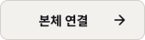

<div align="center">
  <h1></h1>
  <p><strong>파일은 서버에. 설치와 관리는 본체에서.</strong></p>
</div>

[English](README.md) | **한국어** | [日本語](README.ja.md) | [简体中文](README.zh-CN.md)

[](https://github.com/jshsakura/oc-cookingfoil/actions/workflows/ci.yml)
[](https://github.com/jshsakura/oc-cookingfoil/pkgs/container/oc-cookingfoil)
[](./LICENSE)

스위치 홈브류를 위한 개인용 자체 호스팅 파일 서버이자 샵입니다. 파일은 집에 있는 서버에 두고, 관리 페이지 하나로 모두 관리하며, 기기에서는 CookingFoil 클라이언트로 설치합니다.

<p align="center">
  <a href="https://jshsakura.github.io/oc-cookingfoil/?lang=ko"></a>
  <a href="README.ko.md#빠른-시작"></a>
  <a href="README.ko.md#클라이언트-연결"></a>
</p>


실제 영문 UI를 예제 데이터로 촬영했습니다. 아이콘이 없을 때는 앱이 제목 첫 글자 타일을 표시합니다.

## 목차

- [개요](#개요)
- [기능](#기능)
- [빠른 시작](#빠른-시작)
- [폴더](#폴더)
- [설정](#설정)
- [관리 페이지](#관리-페이지)
- [클라이언트 연결](#클라이언트-연결)
- [리버스 프록시와 HTTPS](#리버스-프록시와-https)
- [직접 다운로드 주소](#직접-다운로드-주소)
- [보안](#보안)
- [API](#api)
- [자주 묻는 질문과 문제 해결](#자주-묻는-질문과-문제-해결)
- [개발](#개발)
- [법적 고지](#법적-고지)
- [라이선스와 감사의 말](#라이선스와-감사의-말)

## 개요

CookingFoil 은 직접 운영하는 서버에서 Docker 로 실행합니다. 넣어 둔 파일의 이름과 아이콘을 찾아 붙이고, 그 목록을 기기의 클라이언트에 내려 줍니다.

- **모든 것을 관리 페이지 하나에서 합니다.** 설정, 계정, 기기, 업로드, 홈브류, 패치, 세이브, 이름을 브라우저에서 바꿉니다. 바꾸면 바로 적용되고, 서버를 다시 켜거나 파일을 손으로 고칠 일이 없습니다.
- **아무것도 들어 있지 않습니다.** 게임, 키, 펌웨어, BIOS 파일, RetroArch 는 들어 있지 않습니다. 그 폴더들은 비어 있는 채로 시작하고, 합법적으로 가진 파일을 넣기 전까지 관련 기능은 꺼져 있습니다.
- **처음부터 잠겨 있습니다.** 처음 설정은 서버 로그에 찍힌 코드가 있어야 할 수 있습니다. 기기는 QR 승인이나 서버 대시보드에서 받은 클라이언트로 그 기기만의 접근 키를 받아 연결하므로, 계정 비밀번호가 기기에 남지 않습니다. 콘솔은 접속을 이어 가는 데 비밀번호를 쓰지 않습니다. 아이디와 비밀번호는 연결할 때 한 번만 써서 그 기기를 바로 승인할 수 있습니다.

| 프로젝트 | 실행 위치 | 배포물 |
|---|---|---|
| CookingFoil 서버 (이 저장소) | Docker 호스트 | `ghcr.io/jshsakura/oc-cookingfoil` (linux/amd64, linux/arm64) |
| CookingFoil 클라이언트 | 기기의 홈브류 메뉴 | 서버마다 직접 내려 줍니다. 대시보드의 클라이언트 받기 카드 |

CookingFoil 클라이언트는 GitHub 에 공개하지 않습니다. 서버의 `data/client/` 에 클라이언트 빌드가 있으면(그 폴더에 넣거나 관리 페이지의 업로드 탭에서 "클라이언트" 로 올립니다) 그 서버에 로그인한 사용자가 대시보드에서 받습니다. 관리 페이지에서 클라이언트 빌드 받는 곳을 `github` 로 바꾸면 클라이언트 저장소(`jshsakura/oc-cookingfoil-client`)의 최신 릴리스도 따라가, 둘 중 버전이 높은 빌드를 내려줍니다.

대시보드, 처음 설정, 로그인, 기기 승인 페이지는 영어, 한국어, 일본어, 중국어 간체로 볼 수 있고, 밝은 테마와 어두운 테마를 고를 수 있습니다. 관리 페이지와 운영 안내(`/admin/guide`)는 지금은 한국어로만 제공합니다.

## 기능

- **샵 섹션.** CookingFoil 클라이언트와 대시보드가 읽는 섹션 목록을 내려 줍니다. 위쪽 추천 줄은 관리 페이지에서 정합니다. 자동화 토큰을 가진 스크립트에는 평평한 파일 목록(`/shop.json`)도 내려 줍니다.
- **이름과 아이콘.** 제목, 소개, 그림은 [blawar/titledb](https://github.com/blawar/titledb) 에서 가져오고, titledb 에 없는 파일은 파일 자체에서 읽습니다(직접 가진 `prod.keys` 필요). 이름 언어 순서와 지역은 설정에서 고릅니다.
- **그림, 가격, 평점.** 아이콘, 배너, 스크린샷은 공개 스토어 그림 서비스에서 받아 디스크에 캐시합니다. 스토어 가격, 인기순, Steam 리뷰 점수, IGDB 점수는 선택입니다. 출처마다 끌 수 있고, 그림을 직접 올릴 수도 있습니다.
- **GitHub 홈브류.** 저장소를 추가하면 최신 릴리스(`.nro`, 또는 그것이 든 zip)를 따라갑니다. 앱을 직접 넣어 둘 수도 있습니다. 앱마다 도구나 포팅으로 나누고, 끌 수 있으며, 홈 메뉴 바로가기를 함께 내려 줄 수 있습니다.
- **세이브와 패치.** 세이브 파일과 패치(SD 카드 루트와 같은 구조)를 서버에 보관하고, 클라이언트에서 넣을 것을 고릅니다. 패치는 필수로 표시할 수 있고, 맞춰 만든 게임 업데이트 버전을 적어 둘 수 있습니다.
- **RetroArch 용 레트로 게임.** 시스템별 롬, libretro-thumbnails 의 표지, The Bezel Project 의 베젤, LaunchBox Games Database 의 게임 정보(소개, 배급사, 개발사, 출시일, 인원, 장르, 스크린샷)를 다루고, 빠진 정보는 IGDB 로 채웁니다. 한 게임의 여러 판(아케이드의 원본과 클론 세트, 여러 언어와 지역판)은 카드 하나로 보이고, 나머지 판은 한 번 더 누르면 나옵니다. 직접 준비한 RetroArch 기본 묶음을 기기에 내려 줄 수 있고, 게임마다 홈 메뉴 바로가기를 만들 수 있습니다.
- **기기마다 자기 키로 연결.** CookingFoil 클라이언트가 띄운 QR 을 휴대폰으로 승인하거나, 대시보드에서 받은 클라이언트가 바로 연결합니다. 어느 쪽이든 기기는 자기만의 접근 키를 받고, 비밀번호는 남지 않습니다.
- **계정과 구글 로그인.** 관리자와 일반 사용자 역할의 아이디·비밀번호 계정과, 선택 기능인 구글 로그인을 씁니다. 새 구글 계정은 승인을 기다립니다.
- **2단계 인증이 걸린 관리 페이지.** 관리 페이지는 인증 앱(TOTP) 코드나 별도의 관리자 비밀번호를 한 번 더 묻습니다. 자동화 토큰으로 스크립트가 같은 API 를 쓸 수 있습니다.
- **임시 공유.** 로그인한 사용자가 파일, 메모, 링크를 남기면 운영자가 나중에 정리합니다.
- **텔레그램 알림.** 기기·계정 승인 요청(승인, 거절 버튼 포함), 잠금, 막아 낸 공격 시도, 임시 공유 업로드, 서버 시작을 알립니다.
- **끊기지 않는 다운로드.** 다시 시작할 때 새 요청에는 `503` 과 `Retry-After` 로 답하고, 진행 중인 다운로드는 끝까지 마치게 합니다. 선택 기능인 직접 다운로드 주소는 다운로드만 실어 나르며, 로그인 대신 수명이 짧은 다운로드 토큰으로 엽니다.

## 빠른 시작

Docker 와 Compose v2(`docker compose`, 2.9 이상)가 필요합니다. 이미지는 amd64 와 arm64 에서 돕니다. 시놀로지 NAS 는 아래 [시놀로지 NAS](#시놀로지-nas) 를 따릅니다.

```bash
mkdir cookingfoil && cd cookingfoil
curl -O https://raw.githubusercontent.com/jshsakura/oc-cookingfoil/main/docker-compose.yml
curl -o .env https://raw.githubusercontent.com/jshsakura/oc-cookingfoil/main/.env.example
sed -i "s|^COOK_SECRET_KEY=.*|COOK_SECRET_KEY=$(openssl rand -base64 32)|" .env
docker compose up -d
docker compose logs cookingfoil | grep "setup code"
```

1. `http://<host>:9080/` 을 엽니다. 처음 설정 화면이 나옵니다.
2. 로그에 나온 설정 코드를 넣습니다. 코드는 켤 때마다 바뀌므로, 로그를 볼 수 없는 사람은 서버를 차지할 수 없습니다.
3. 관리자 계정을 만들고 인증 앱을 등록합니다.
4. 관리 페이지가 열립니다. 나머지는 모두 거기서 합니다.

클라이언트에는 브라우저로 연 주소를 그대로 넣습니다. 업데이트는 `docker compose pull && docker compose up -d` 로 합니다.

compose 파일을 줄이면 이렇습니다([전체 파일](./docker-compose.yml)에는 줄마다 설명이 있습니다).

```yaml
services:
  cookingfoil:
    image: ghcr.io/jshsakura/oc-cookingfoil:latest
    restart: unless-stopped
    stop_grace_period: 40s
    env_file:
      - .env
    environment:
      PUID: ${PUID:-1000}
      PGID: ${PGID:-1000}
    ports:
      - "9080:80"
    volumes:
      - ./storage:/storage
```

### 시놀로지 NAS

1. 패키지 센터에서 **Container Manager** 를 설치합니다(DSM 7.2 이상).
2. File Station 에서 `docker/cookingfoil` 같은 폴더를 만들고 `docker-compose.yml` 과 `.env`(`.env.example` 을 복사한 것)를 넣습니다. `.env` 의 `COOK_SECRET_KEY` 에는 아무 컴퓨터에서 `openssl rand -base64 32` 로 만든 키를 넣습니다.
3. `.env` 의 `PUID`, `PGID` 를 폴더 주인 계정 값으로 맞춥니다. SSH 에서 `id <계정>` 으로 봅니다. 처음 만든 관리자 계정은 보통 `1026`, `users` 그룹은 `100` 입니다.
4. 모든 것을 이미 있는 공유 폴더에 두려면 `COOK_STORAGE_PATH=/volume1/cookingfoil` 처럼 경로를 넣고, 그 계정에 그 폴더의 읽기·쓰기 권한을 줍니다.
5. Container Manager 에서 **프로젝트**, **생성** 을 차례로 누르고, 2단계의 폴더를 고른 뒤 그 안의 `docker-compose.yml` 을 그대로 씁니다. 마법사를 끝까지 진행합니다.
6. 설정 코드는 **컨테이너**, `cookingfoil`, **로그** 에 있습니다. `http://<NAS 주소>:9080/` 을 엽니다. DSM 방화벽을 켰다면 9080 포트를 엽니다.

## 폴더

```
cookingfoil/
├── docker-compose.yml
├── .env              # optional; defaults for the first start
└── storage/          # the one folder mounted at /storage; the server makes the rest
    ├── incoming/     # drop box: files put here are sorted into the folders below
    ├── games/        # sorted Switch games, one folder per game with update/ and DLC/
    ├── homebrew/     # .nro apps, app folders, or a release zip left in its own folder
    ├── retro/        # retro ROMs, art and the RetroArch base pack
    ├── patches/      # patches by base title id, and homebrew/<app>/
    ├── saves/        # save files by title id, and homebrew/<app>/
    ├── keys/         # recommended: your own prod.keys (or upload it on the admin page)
    └── data/         # cache, accounts and every setting saved on the admin page. Back this one up
```

저장 폴더는 `.env` 의 `COOK_STORAGE_PATH` 로 바꾸지 않으면 `docker-compose.yml` 옆의 `./storage` 입니다. 서버는 켤 때 그 안에 위 폴더들을 만들고, `COOK_<이름>_DIR` 로 그중 하나를 다른 곳에 둘 수도 있습니다.

정리를 맡기려면 파일을 `storage/incoming/` 에 넣습니다. 1분 동안 바뀌지 않은 파일부터 파일 안의 정보(`prod.keys` 가 없으면 이름이나 티켓)로 타이틀 ID 와 버전을 읽어 이름에 `[TITLEID][vN]` 을 붙이고, `games/` 안에 게임마다 폴더 하나로 본편 옆에 `update/` 와 `DLC/` 를 두어 옮깁니다. 이미 폴더가 있는 게임은 그 폴더를 쓰고, 새 게임은 그 이름으로 폴더를 만듭니다. 레트로 롬은 기종 이름 폴더(`incoming/snes/`)에 넣으면 `retro/` 로, `.nro` 하나짜리는 `homebrew/` 로 갑니다. 덮어쓰는 일은 없고, 옮기지 못한 파일은 `incoming/` 에 남아 관리 페이지(라이브러리, 임시 폴더)에 이유가 나옵니다. 서버는 임시 폴더를 이름이나 내용이 아니라 위치로 알아보므로, `games/` 안의 폴더를 정리할 대상으로 착각하는 일은 없습니다.

**따로 마운트하던 서버를 옮길 때.** 새로 설치하면 저장 폴더 하나만 마운트합니다. 파일이 아직 따로 된 폴더(`./games`, `./data`, `./keys` 등, 또는 `COOK_<이름>_PATH` 로 정한 곳)에 있는 서버는 `docker-compose.legacy.yml` 을 함께 씁니다. `docker compose -f docker-compose.yml -f docker-compose.legacy.yml up -d` 로 켜거나 `.env` 에 `COMPOSE_FILE=docker-compose.yml:docker-compose.legacy.yml` 을 넣습니다. 이 파일 없이 켜면 그 폴더들이 마운트되지 않아 서버가 빈 상태로 뜹니다. 디스크의 파일은 건드리지 않습니다. 함께 쓰면 파일이 있는 옛 폴더는 그대로 쓰면서 관리 페이지 개요에 알리고, 빈 폴더는 무시합니다. 옮기기를 끝내려면 서버를 멈추고 각 폴더의 내용을 위 이름으로 저장 폴더 안에 옮긴 뒤 legacy 파일을 빼고 켭니다. 옮기는 동안 덮어쓰는 일은 없고, `games/incoming/` 에 있던 것은 같은 이름이 있거나 다른 디스크에 있지 않으면 `incoming/` 으로 옮깁니다. 남은 것은 개요에 나옵니다.

서버는 사용자 `PUID`, 그룹 `PGID` 로 돕니다(`.env` 에 없으면 1000, 1000). 그래서 이 폴더들에 서버가 쓰는 파일은 내 것이 됩니다. 내 값은 호스트에서 `id` 로 봅니다. 켤 때 데이터 폴더를 그 사용자에게 넘기고, 쓸 수 없는 라이브러리 폴더는 고치는 명령과 함께 로그에 알립니다. 그 밖에는 바꾸지 않습니다. `PUID=0` 이면 root 로 돌고, compose 파일에 `user:` 를 적으면 그 사용자로 그대로 돕니다.

`retro/` 안은 이렇게 생겼습니다.

```
retro/
├── roms/<system>/<game file>                          # a game, or a subfolder holding one
├── thumbnails/<system>/Named_Boxarts/<game name>.png  # box art (fetched, or your own)
├── bezels/<system>/<game name>.png                    # bezels (fetched, or your own)
├── screenshots/                                       # game screenshots (fetched)
├── retroarch/                                         # your RetroArch base pack (optional)
├── systems.json                                       # optional overrides of folder and libretro names
└── arcade-names.json                                  # optional arcade display names
```

시스템마다 짧은 id 로 된 폴더가 하나 있습니다. `nes` `snes` `gb` `gbc` `gba` `n64` `nds` `md` `sms` `gg` `segacd` `saturn` `pce` `pcecd` `ps1` `psp` `ngp` `ws` `arcade` `neocd` 입니다. 아케이드 게임은 FinalBurn Neo 세트 이름(예: `mslug.zip`)을 그대로 씁니다. 표지는 파일 이름의 영어 제목으로 찾으므로 `내 제목 (English Title)` 같은 이름이 가장 잘 맞습니다.

RetroArch 기본 묶음은 기기가 게임을 하기 전에 한 번 받아야 하는 것들입니다. `retroarch.nro`, `retroarch.cfg` 와 RetroArch 가 쓰는 폴더(`cores/`, `assets/`, `system/` 등)를 `retro/retroarch/` 아래에 넣습니다. 게임이 있는 시스템에 어떤 BIOS 파일이 빠졌는지는 관리 페이지가 알려 줍니다. CookingFoil 은 BIOS 를 절대 포함하지 않습니다.

## 설정

대부분의 설정은 관리 페이지에서 바꾸고 바로 적용됩니다. `.env` 의 값은 처음 시작할 때의 기본값일 뿐입니다. 관리 페이지에서 설정을 바꾸면 그 값이 우선하고, "compose 값으로"를 누르면 `.env` 값으로 돌아갑니다. 모든 변수와 설명은 [`.env.example`](./.env.example) 에 있습니다.

아래는 관리 페이지가 생기기 전에 알아야 하거나, 일부러 관리 페이지에서 뺀 것입니다.

| 변수 | 기본값 | 용도 |
|---|---|---|
| `COOK_SECRET_KEY` | _(필수)_ | 데이터 폴더에 두는 비밀값을 암호화합니다(AES-256-GCM). `openssl rand -base64 32` 로 만들고 잘 보관합니다. 새 키로는 예전 키가 잠근 값을 열 수 없습니다 |
| `COOK_HOST_PORT` | `9080` | 호스트 포트 |
| `PUID` / `PGID` | `1000` / `1000` | 서버가 도는 사용자와 그룹입니다. 서버가 쓴 파일이 내 것이 됩니다. `0` 이면 root 로 돕니다 |
| `COOK_TRUST_PROXY` | _(비어 있음)_ | 클라이언트 주소를 정해도 되는 프록시 단계. 예: `loopback, uniquelocal` |
| `COOK_FIRST_RUN_SETUP` | `true` | `false` 면 계정이 없는 서버를 `/setup` 으로 보내지 않고 열어 둡니다 |
| `COOK_AUTH_USERS` | _(비어 있음)_ | `/setup` 대신 미리 만들어 둘 계정. `user:pass,user2:pass2`. 첫 계정이 관리자이고 나머지는 일반 사용자입니다 |
| `COOK_ADMIN_PASSWORD` | _(비어 있음)_ | 관리자 비밀번호와 인증 앱을 모두 잃었을 때 다시 들어가는 방법(12자 이상) |
| `COOK_ADMIN_TOTP_SECRET` | _(비어 있음)_ | `/setup` 대신 인증 앱 시크릿을 직접 관리합니다 |
| `COOK_DIRECT_EDGE_SECRET` | _(비어 있음)_ | 직접 다운로드 프록시와 나누는 시크릿. [아래](#직접-다운로드-주소) 참고 |
| `COOK_DIRECT_COUNTRIES` | _(비어 있음)_ | 직접 다운로드 주소를 쓸 수 있는 나라를 ISO 코드로 적습니다(`KR,JP`). Cloudflare 가 다른 나라로 본 클라이언트는 원래 주소를 씁니다. 비워 두면 나라를 가리지 않습니다 |
| `COOK_RATE_LIMIT_PER_MIN`, `COOK_RATE_LIMIT_BURST` | `1200`, `300` | 주소 하나가 1분에 보낼 수 있는 요청 수와, 한꺼번에 보낼 수 있는 요청 수 |
| `COOK_AUTH_MAX_FAILURES`, `COOK_LOCKOUT_TTL_HOURS` | `5`, `0` | 주소를 잠그기 전까지 허용하는 로그인 실패 횟수와 잠금 시간(`0` 이면 관리자가 풀 때까지) |
| `COOK_ADMIN_SESSION_HOURS` | `8` | 관리 페이지 로그인이 유지되는 시간 |
| `COOK_OUTBOUND_PRIVATE_HOSTS` | _(비어 있음)_ | 사설, 루프백, CGNAT 주소로 풀려도 서버가 가져와도 되는 호스트 이름입니다. 예를 들어 tailnet 안의 titledb 미러입니다. 관리 페이지에서 넣은 그 밖의 주소가 내부망을 가리키면 거절합니다 |

보통 관리 페이지(설정 탭)에서 바꾸는 것들입니다. 모두 `.env` 로 미리 정할 수도 있습니다.

| 설정 | 변수 | 기본값 |
|---|---|---|
| QR 기기 연결(대시보드의 클라이언트 받기에도 필요합니다) | `COOK_DEVICE_PAIRING` | `true` |
| 기기 승인 방식 | `COOK_DEVICE_AUTO_APPROVE` | `true`: 연결할 때 아이디와 비밀번호를 한 번 보낸 기기는 바로 승인합니다. `false`: 관리자가 하나씩 승인합니다. `all`: 요청하는 기기를 모두 승인합니다 |
| 공개 주소 | `COOK_PUBLIC_BASE_URL` | 요청마다 알아냄 |
| 웹 업로드 | `COOK_UPLOADS_ENABLED` | `false` |
| 임시 공유 | `COOK_INBOX_ENABLED` | `true` |
| 이름 언어 순서 | `COOK_LANG_PRIORITY` | `ko,en,ja,en-US` |
| titledb 받기, 지역, 출처 | `COOK_TITLEDB_AUTO_FETCH`, `COOK_TITLEDB_REGIONS`, `COOK_TITLEDB_URL` | 켜짐, 내장 목록, blawar/titledb |
| 클라이언트 빌드 받는 곳 | `COOK_CLIENT_SOURCE`, `COOK_CLIENT_RELEASE_REPO`, `COOK_CLIENT_RELEASE_TAG` | `manual`: 올린 빌드만 씁니다. `github` 는 `jshsakura/oc-cookingfoil-client` 의 최신 릴리스(태그를 넣으면 그 태그)도 따릅니다 |
| 파일에서 아이콘 읽기 | `COOK_EXTRACT_ICONS` | `missing` |
| 스토어 가격, 인기순, 그림 | `COOK_ESHOP_PRICES`, `COOK_ESHOP_POPULARITY`, `COOK_ESHOP_ARTWORK` | 켜짐 |
| 리뷰 점수, 레트로 게임 정보 | `COOK_RATING_SYNC`, `COOK_RETRO_META` | 켜짐 |
| 레트로 기종 폴더 만들기 | `COOK_RETRO_SCAFFOLD` | 켜짐 |
| 다운로드당 연결 수 | `COOK_DOWNLOAD_MAX_CONNECTIONS` | `4` |
| 직접 다운로드 주소, 토큰 수명 | `COOK_PUBLIC_DIRECT_BASE_URL`, `COOK_DOWNLOAD_LINK_TTL` | 꺼짐, `21600` 초 |
| 안전한 재시작 | `COOK_RESTART_RETRY_AFTER`, `COOK_RESTART_GRACE` | `20` 초, `25` 초 |
| 폴더 동기화, 매일 백업 | `COOK_SYNC_HOURS`, `COOK_BACKUP_DAYS` | `6` 시간마다, `14` 일 보관 (`0` 이면 끕니다) |

외부 서비스 키(IGDB, SteamGridDB, Dropbox, GitHub), 구글 로그인, 텔레그램 알림은 관리 페이지에서 넣습니다. 각 키를 어디서 받는지도 거기 나옵니다. 모두 선택이며, 없으면 그 키가 필요한 기능만 꺼집니다.

## 관리 페이지

`/admin` 을 엽니다. 로그인한 뒤 인증 앱 코드나 관리자 비밀번호를 한 번 더 묻습니다(관리자 역할의 구글 계정으로 로그인했으면 묻지 않습니다). 바꾼 것은 모두 `data/` 아래에 저장되고 바로 적용됩니다.

| 탭 | 하는 일 |
|---|---|
| 개요 | 서버 상태, 설정 경고, 게임 이름을 어디서 가져오는지 |
| 사용자 | 계정과 역할, 승인을 기다리는 구글 계정 |
| 기기 | 기기 승인과 거절, 이름 바꾸기와 끊기, 기기 하나 전용 접속 정보 만들기 |
| 설정 | 서버 동작(기기 승인, 업로드, 공개 주소, 환영 메시지, 이름과 지역, 스토어 정보, 평점, 다운로드, 안전한 재시작), 외부 서비스 키, 구글 로그인, 관리자 비밀번호, 인증 앱, 자동화 토큰 |
| 알림 | 텔레그램 알림과 알릴 일 |
| 로그 | 잠긴 주소, 이유가 적힌 거절 기록, 클라이언트 오류 기록 |
| 추천 | 클라이언트 홈 화면 맨 위의 줄 |
| 라이브러리 | 파일 찾기와 지우기, 패치와 세이브 편집·이동·삭제, 필수 패치 표시, 게임 이름·소개·추가 정보 쓰기 |
| 업로드 | 게임, 레트로 롬, 패치, 세이브, 홈브류를 파일이나 폴더째 올리기 |
| 임시 공유 | 로그인한 사용자가 남긴 파일, 메모, 링크 |
| 홈브류 | GitHub 저장소 추가, 앱 켜기·끄기, 빼기, 직접 넣은 앱을 저장소와 잇기 |
| 레트로 | 표지와 베젤, 표지 올리기, 표시 이름, 변형판, 롬 지우기 |

`/admin/guide` 의 운영 안내에 작업마다 하는 법과 관리 페이지가 쓰는 API 가 정리돼 있습니다. 자동화 토큰을 가진 스크립트나 AI 도우미도 같은 일을 할 수 있습니다.

## 클라이언트 연결

콘솔은 CookingFoil 클라이언트로 연결하며, 길은 두 가지입니다. 둘 다 기기에 그 기기만의 접근 키를 주고 처음부터 켜져 있습니다. 콘솔은 접속을 이어 가는 데 비밀번호를 쓰지 않습니다. 아이디와 비밀번호는 연결할 때 한 번만 써서 그 기기를 바로 승인할 수 있습니다. Tinfoil 과 CyberFoil 은 지원하는 클라이언트가 아닙니다.

**1. CookingFoil 클라이언트, QR 로 연결.** 홈브류 메뉴에서 클라이언트를 열고 서버 주소를 넣으면 QR 코드와 8자리 기기 코드가 뜹니다. 휴대폰으로 QR 을 찍거나 `/pair` 에서 기기 코드를 입력한 뒤, 로그인해 승인합니다. 기기는 자기만의 접근 키를 받습니다. 승인 방식이 "로그인한 기기는 바로 승인"(기본값)이면 클라이언트에 넣은 아이디와 비밀번호로도 바로 승인됩니다. 그 비밀번호는 이때 한 번만 확인하고, 그 뒤로 기기는 접근 키로만 접속합니다.

**2. CookingFoil 클라이언트, 대시보드에서 받기.** 서버의 대시보드에 로그인해 클라이언트 받기 카드를 씁니다. `switch/cookingfoil/cookingfoil.nro` 와, 이 서버 주소와 한 번 쓰는 등록 토큰이 든 `config.json` 이 함께 담긴 zip 을 받습니다. `switch/` 폴더를 SD 카드에 복사하고 클라이언트를 엽니다. 처음 켤 때 클라이언트가 토큰을 자기 접근 키로 바꾸고(`POST /api/pair/enroll`) 내 계정 아래로 승인되므로, 따로 찍을 것이 없습니다. 토큰은 한 번만, 받은 뒤 24시간 안에만 쓸 수 있습니다. 아직 쓰지 않은 다운로드는 같은 화면이나 관리 페이지의 기기 탭에서 거둘 수 있습니다. 쓰기 전까지는 zip 을 열쇠처럼 다룹니다.

어느 쪽으로 연결했든, 클라이언트는 접근 키를 12시간짜리 세션 토큰으로 바꾸고(`GET /api/session`) 그 뒤로는 토큰만 보냅니다. 연결한 뒤에는 서버에서 스스로 업데이트하고, 홈 메뉴 바로가기도 직접 만들 수 있습니다. 새 기기 키로 옮겨 가는 기기는 `POST /api/pair/rebind` 로 승인을 그대로 이어 갑니다.

## 리버스 프록시와 HTTPS

CookingFoil 은 일반 HTTP 로 동작합니다. 집 밖에서 접속하려면 HTTPS 를 처리하는 리버스 프록시나 터널(nginx, Caddy, Traefik, Cloudflare Tunnel 등) 뒤에 둡니다.

그대로 쓸 수 있는 Caddy(HTTPS 를 한 스택으로), nginx, Cloudflare Tunnel 설정 파일은 [`examples/`](examples/) 에 있습니다.

- `COOK_TRUST_PROXY` 에는 클라이언트 주소를 정해도 되는 단계만 넣습니다. 같은 호스트나 내부망의 프록시라면 `loopback, uniquelocal` 입니다. `true` 는 모든 단계를 믿으므로, 프록시를 거치지 않고는 서버에 닿을 수 없을 때만 안전합니다. 이 설정이 없으면 모든 클라이언트가 프록시의 주소 하나로 보여서, 낯선 사람 한 명의 로그인 실패가 모두를 잠글 수 있습니다. 관리 페이지가 이 상황을 보면 경고합니다. `X-Forwarded-Host` 와 `X-Forwarded-Proto` 도 이 단계에서 온 것만 믿고, 그 밖에서 오면 연결 자체의 `Host`(설정했다면 `COOK_PUBLIC_BASE_URL`)를 씁니다.
- 전달 헤더 없이 루프백으로 들어온 요청은 이 서버 자신으로 보고 잠금을 건너뜁니다. 같은 호스트의 프록시가 그런 헤더를 붙이지 않으면(`proxy_set_header` 없는 nginx, `socat`, `ssh -L`) 모든 클라이언트가 이 서버 자신으로 보이므로, 그때는 `COOK_LOCKOUT_TRUST_LOOPBACK=false` 로 둡니다.
- 프록시가 `X-Forwarded-For`, `X-Forwarded-Proto`, `X-Forwarded-Host` 를 넘기게 합니다. 다운로드와 그림 주소는 절대 주소이고 이 헤더로 만듭니다. 프록시가 `Host` 를 바꾼다면 관리 페이지에서 공개 주소를 정합니다(또는 `COOK_PUBLIC_BASE_URL=https://shop.example.org`).
- 큰 응답과 오래 걸리는 요청을 허용합니다. 기기는 Range 요청을 여러 번 나눠 받고, 파일 하나가 수십 GB 일 수 있습니다.
- CookingFoil 앞에 둔 개발 서버(Vite 등)는 모르는 `Host` 헤더를 `403` 으로 거절할 수 있습니다. 프록시를 의심하기 전에 `curl -H "Host: shop.example.org" http://127.0.0.1:9080/` 로 원본을 직접 확인합니다.

## 직접 다운로드 주소

어떤 구성에서는 샵이 거치는 터널이나 CDN 이 아주 큰 파일에 느리거나 제한이 있습니다. 직접 다운로드 주소를 쓰면, 요청한 클라이언트는 다운로드만 실어 나르는 두 번째 HTTPS 주소에서 받고, 목록과 로그인은 원래 주소에 그대로 둡니다.

동작 방식은 이렇습니다.

1. 컨테이너와 같은 호스트의 리버스 프록시가 예를 들어 `https://dl.example.org` 를 맡습니다. 이 프록시는 `Authorization: Bearer …` 가 붙은 `GET`, `HEAD` 요청만 넘기고, `X-Forwarded-For` 를 직접 쓰며, `Host` 를 직접 다운로드 주소(포트가 있으면 포트까지)로 정하고, `X-CookingFoil-Edge: <secret>` 을 붙입니다. 원래 쓰는 터널로 들어온 요청은 넘기지 않아야 합니다.
2. 같은 시크릿을 `.env` 의 `COOK_DIRECT_EDGE_SECRET` 에 넣습니다. 이 값은 관리 페이지 설정이 아닙니다. 없으면 직접 다운로드 주소는 아무것도 내주지 않습니다.
3. 주소는 관리 페이지(설정 탭의 다운로드)나 `COOK_PUBLIC_DIRECT_BASE_URL` 에 넣습니다. 반드시 `https://` 여야 합니다.
4. HTTPS 로 `X-CookingFoil-Features: direct-token` 을 보내는 로그인한 클라이언트는 `X-CookingFoil-Download-Token` 헤더를 받고, 목록의 다운로드 주소가 직접 다운로드 주소를 가리킵니다. 함께 오는 `X-CookingFoil-Download-Origin` 은 직접 다운로드 주소의 origin 이고, 클라이언트는 그곳에만 토큰을 Bearer 토큰으로 보냅니다.

토큰은 서버가 서명하고(`data/security/security.db` 에 암호화해 둔 무작위 키로 HMAC-SHA256), `COOK_DOWNLOAD_LINK_TTL` 초(기본 6시간) 동안 유효하며, 토큰을 받은 계정이나 기기가 더는 로그인할 수 없게 되면 바로 쓸 수 없습니다. 거절에는 `X-CookingFoil-Token: invalid | expired | revoked | blocked` 가 붙고, 틀린 토큰을 너무 많이 보낸 주소는 한동안 막힙니다. 이 기능을 알리지 않는 클라이언트(예전 클라이언트 빌드, 브라우저)와 일반 HTTP 요청은 전과 똑같은 목록을 봅니다. Cloudflare 를 거쳐 온 요청의 `CF-IPCountry` 가 `COOK_DIRECT_COUNTRIES`(정해 두었을 때)에 없는 나라면 원래 주소를 그대로 받습니다.

DNS 인증서와 DDNS 까지 갖춘 Caddy 설정 전체는 [`examples/direct-download/`](examples/direct-download/) 에 있습니다.

가장 작은 nginx 예시입니다(인증서, 포트, 시크릿은 맞게 고칩니다).

```nginx
server {
  listen 443 ssl;
  server_name dl.example.org;
  # ssl_certificate ...; ssl_certificate_key ...;

  location / {
    limit_except GET HEAD { deny all; }
    if ($http_authorization !~ "^Bearer ") { return 401; }
    proxy_set_header Host dl.example.org;
    proxy_set_header X-Forwarded-For $remote_addr;
    proxy_set_header X-Forwarded-Proto https;
    proxy_set_header X-Forwarded-Host "";
    proxy_set_header CF-Connecting-IP "";
    proxy_set_header X-CookingFoil-Edge "change-me-to-a-long-random-string";
    proxy_buffering off;
    proxy_pass http://127.0.0.1:9080;
  }
}
```

## 보안

CookingFoil 은 내 프록시 뒤에서 인터넷에 놓이는 것을 전제로 만들었습니다. 그래서 잠긴 채로 시작하고, 켠 것만 엽니다. 이 절에서는 무엇을 설정할지, 들어오는 길마다 무엇을 믿는지, 접근을 어떻게 거둬들이는지 설명합니다.

### 권장 설정

1. **모든 콘솔을 QR 이나 대시보드의 클라이언트 받기로 연결합니다.** 기기마다 따로 거둘 수 있는 자기 키를 갖게 되고, 비밀번호를 들고 있는 콘솔은 없습니다.
2. **관리 페이지의 2단계 인증을 유지합니다.** 처음 설정할 때 인증 앱을 등록합니다. 별도의 관리자 비밀번호(`COOK_ADMIN_PASSWORD`, 12자 이상)로 대신할 수도 있는데, 샵 계정의 어느 비밀번호와도 다르게 합니다.
3. **밖에서는 HTTPS 로만 들어옵니다.** HTTPS 를 처리하는 리버스 프록시나 터널을 거쳐 서버에 닿게 하고, 평문 HTTP 포트는 인터넷에 열지 않습니다.
4. **`COOK_TRUST_PROXY` 에는 프록시 구간만 넣고** 그보다 넓게 잡지 않습니다. [리버스 프록시와 HTTPS](#리버스-프록시와-https) 를 봅니다.
5. **승인 방식은 알고 고릅니다.** "로그인한 기기는 바로 승인"(기본값)과 "관리자가 하나씩 승인" 이 안전한 쪽입니다. "모두 승인" 은 내 기기만 닿을 수 있는 서버에서만 씁니다.
6. **`data/` 를 보호하고 백업합니다.** 계정, 기기 키, 서명 키가 모두 여기에 있습니다.

### 들어오는 길마다 믿는 것

| 누구 | 무엇으로 증명하나 | 할 수 있는 일 |
|---|---|---|
| 대시보드 사용자 | 계정 아이디와 비밀번호, 또는 구글 로그인(새 구글 계정은 승인을 기다립니다) | 둘러보기, 자기 기기 승인, 클라이언트 받기, 임시 공유, 웹 업로드를 켰다면 올리기 |
| 관리자 | 관리자 역할의 계정과, 인증 앱 코드 또는 관리자 비밀번호 | 관리 페이지의 모든 일. 관리자 세션은 `COOK_ADMIN_SESSION_HOURS` 동안 유지됩니다 |
| 연결한 기기 | 기기 키와 접근 키, 그 뒤로는 같은 기기 키에 묶인 12시간짜리 세션 토큰. 비밀번호는 연결할 때 한 번만 통하고 다른 곳에서는 통하지 않습니다 | 목록 읽기와 다운로드 |
| 자동화 토큰 | `Authorization: Bearer cft_…` | `/admin/api/` 아래의 관리자 API 를, 만든 관리자로서 씁니다. 토큰을 만들거나 거두지 못하고, 관리자 로그인 방식, 기기 승인, 알림, 로그인과 주소에 관한 설정도 바꾸지 못합니다 |
| 직접 다운로드 주소 | 엣지 시크릿을 가진 로컬 프록시를 거쳐 온, 수명이 짧은 다운로드 토큰 | `GET`, `HEAD` 다운로드만 |

모두가 보는 것(그림, 소개, 게임 폴더의 파일)을 바꾸는 일과 업로드 목록은 관리자 계정만 할 수 있습니다. 일반 사용자 계정과 연결한 기기는 읽기만 합니다.

### 디스크에 남기는 것

- 계정 비밀번호는 scrypt 해시로만 남깁니다.
- 기기 접근 키와 자동화 토큰은 SHA-256 해시로만 남깁니다. 원래 값은 만들 때 한 번만 보여 줍니다.
- 서버가 다시 읽어야 하는 비밀값(관리자 인증 앱 시크릿, 세션과 다운로드 토큰 서명 키, 구글과 IGDB 클라이언트 시크릿)은 `COOK_SECRET_KEY` 로 AES-256-GCM 암호화해 둡니다. 키는 데이터 폴더가 아니라 `.env` 에 있어서, 데이터 폴더만 복사해 가서는 아무것도 열 수 없습니다.
- `COOK_SECRET_KEY` 는 따로 보관합니다. 키가 없으면 서버가 시작하지 않고, 새 키로는 예전 키가 잠근 값을 열 수 없습니다.
- 계정, 승인한 기기, 기기 전용 로그인, 토큰, 저장한 설정, 감사 기록, 암호화한 비밀값은 `data/security/security.db`(SQLite)에 두고, 서버 계정만 읽을 수 있습니다(0600). 아래의 색인과 달리 다시 만들 수 없으니 데이터 폴더와 함께 백업합니다.
- 세이브, 홈브류, 레트로 폴더를 읽은 목록과 파일 해시는 `data/cookingfoil.db`(SQLite)에 둡니다. 그래서 재시작한 뒤에도 바로 목록을 보여 줍니다. 폴더의 색인일 뿐이라 지우면 서버가 폴더를 다시 읽습니다.
- 라이브러리의 모든 폴더를 `COOK_SYNC_HOURS` 시간마다 처음부터 다시 읽고, 설정 탭의 **지금 동기화** 를 누르면 바로 읽습니다. 새 파일은 폴더 감시가 들어오는 대로 잡고, 이것은 놓친 것을 채웁니다.
- 하루에 한 번 보안 데이터베이스와 손으로 관리하는 파일(다운로드·알림 기록, NSZ 대기열, 설명, 손으로 고친 이름, 홈브류 출처, 올린 그림)을 `data/backups/<날짜>/`(0700)에 복사하고 `COOK_BACKUP_DAYS` 일 동안 둡니다. 설정 탭의 **지금 백업** 을 누르면 바로 만듭니다. 롬, 이미지, 캐시는 다시 생기므로 넣지 않습니다. 디스크 고장에 대비하려면 `data/backups` 를 다른 디스크에 복사합니다.

### 기기를 승인하는 방식

로그인한 사용자의 QR 승인과 대시보드에서 받은 클라이언트는 승인 방식과 상관없이 늘 그 사용자의 계정 아래로 기기를 승인합니다. 그러니 계정을 가진 사람은 누구나 기기를 더할 수 있고, 계정은 믿는 사람에게만 줍니다. 그 밖의 기기는 설정 탭의 승인 방식이 정합니다.

- **관리자가 하나씩 승인.** 관리자가 기기 탭이나 텔레그램 알림의 승인 버튼으로 승인할 때까지 기다립니다.
- **로그인한 기기는 바로 승인**(기본값). 연결을 요청하면서 계정 아이디와 비밀번호를 보낸 기기는 그 자리에서 승인합니다. 비밀번호는 이때만 확인합니다. 아무것도 보내지 않은 기기는 여전히 기다립니다.
- **모두 승인.** 연결을 요청하는 기기는 로그인 여부와 상관없이 모두 승인합니다. 승인 단계를 통째로 포기하는 설정이라, 내 기기만 닿을 수 있는 서버에서만 씁니다.

### 집 안 네트워크의 평문 HTTP

CookingFoil 자체는 평문 HTTP 로 말합니다. `http://` 로 붙으면 기기가 연결할 때 보내는 비밀번호, 세션을 받을 때의 접근 키, 세션 토큰이 암호화되지 않은 채 네트워크를 지나갑니다. 같은 네트워크의 다른 사람이 이것을 읽을 수 있습니다. 세션 토큰은 12시간 뒤에 끝나고 기기 키에 묶여 있어 피해를 줄이지만, 막지는 못합니다. 나 혼자 쓰는 네트워크가 아니라면 HTTPS 를 씁니다. 직접 다운로드 토큰은 평문 HTTP 로는 아예 내주지 않습니다.

### 접근을 거둬들이는 법

- **기기:** 기기 탭에서 접근 키를 회수합니다(키 재발급도 됩니다). 사용자는 자기가 승인한 기기를 `/pair` 에서 똑같이 거둘 수 있습니다. 그 기기의 세션 토큰은 바로 멈춥니다.
- **아직 쓰지 않은 클라이언트 다운로드:** 기기 탭이나 `/pair` 에서 거둡니다. 이미 쓴 것은 다른 기기와 똑같이 다룹니다.
- **계정:** 계정 탭에서 끄거나 지웁니다. 그 계정의 세션 토큰과 다운로드 토큰이 함께 멈춥니다. 비밀번호를 바꿔도 세션이 끝납니다. 그 계정이 승인한 기기도 기기 탭에서 함께 거둡니다.
- **자동화 토큰:** 설정 탭에서 거둡니다.
- **모든 토큰을 한꺼번에:** `docker compose exec cookingfoil node -e 'import("./src/db/security-stores.js").then((s) => ["download-link", "user-session"].forEach((n) => s.deleteSecret(n)))'` 를 실행하고 서버를 다시 시작합니다. 웹 로그인을 포함해 모든 세션과 다운로드 토큰이 끝나고, 기기는 접근 키로 다시 로그인합니다.
- **잠긴 주소:** 로그 탭에서 풉니다.

### 기본으로 들어 있는 보호 장치

- 비밀번호는 scrypt 해시로 저장합니다. 등록 토큰과 자동화 토큰은 한 번만 보여 주고 해시만 남깁니다.
- 로그인을 `COOK_AUTH_MAX_FAILURES` 번 틀리면 그 주소를 잠그고, 주소마다 요청 한도가 있습니다. 관리자 코드를 여러 번 틀리면 계정과 주소를 잠급니다.
- 알려진 공격 경로, 경로 이탈, 제어 문자, 지나치게 긴 주소는 로그인 전에 거절하고, 같은 잠금 횟수에 셉니다. 텔레그램 알림으로도 알릴 수 있습니다.
- 브라우저에서 오는 쓰기 요청과 WebSocket 연결은 서버 자기 화면에서 온 것만 받습니다. WebSocket 메시지는 4 KB 까지입니다.
- 관리자가 넣는 바깥 서비스 주소는 사설 네트워크를 가리킬 수 없습니다. `COOK_OUTBOUND_PRIVATE_HOSTS` 에 적은 호스트만 예외입니다.
- 응답에는 방어용 헤더(`nosniff`, `DENY` 프레임 차단, 리퍼러 없음)가 붙습니다. 거절은 모두 이유와 함께 로그 탭과 `X-CookingFoil-Deny` 헤더에 남습니다.
- 관리 페이지에 저장한 시크릿은 다시 보여 주지 않습니다. 웹 업로드는 켜기 전까지 꺼져 있습니다.

취약점 제보는 [SECURITY.md](./SECURITY.md#한국어) 를 봅니다. 공개 이슈로 올리지 말아 주세요.

## API

기기 연결, 등록, `/healthz` 를 빼면 모든 엔드포인트에는 연결한 기기의 키나 세션 토큰, 또는 대시보드 로그인 세션이 있어야 합니다. Basic `Authorization` 헤더는 기기 연결 경로에서만 통하고, 그 밖의 곳에서는 아무것도 열지 않으며 어떤 엔드포인트도 그것을 요구하지 않습니다.

| 엔드포인트 | |
|---|---|
| `GET /shop.json` | 자동화용 평평한 파일 목록 `{ files: [...] }`. 파일마다 `[TITLEID][vN]` 표식이 붙은 이름이 있습니다. 관리 페이지에서 만든 자동화 토큰(`Authorization: Bearer cft_…`)만 읽습니다 |
| `GET /api/shop/sections` | CookingFoil 클라이언트와 대시보드가 읽는 섹션 목록 |
| `GET /api/shop/info` | 서버 버전, 다운로드 힌트, 클라이언트가 믿고 쓸 수 있는 `features` |
| `GET /api/activity` | 로그인한 사용자는 실행 중인 작업과 최근 작업을 조회합니다. 중지는 관리자 API에서 관리자만 할 수 있습니다. |
| `GET /api/title/:id?lang=`, `/api/title/:id/extras` | 항목 하나의 자세한 정보와 추가 파일 |
| `GET /api/shop/icon/:id`, `/api/shop/banner/:id`, `/api/shop/screenshot/:id/:n` | 그림 |
| `GET /api/homebrew`, `/api/homebrew/:id/download`, `/file?path=`, `/bundle`, `/archive`, `/forwarder` | 홈브류 앱(`.nro` 하나 또는 `switch/<app>/` 폴더 전체)과 홈 메뉴 바로가기. 관리 페이지에서 끈 앱은 빠집니다 |
| `GET /api/patches?lang=`, `/api/patches/:id/download` | 패치 |
| `GET /api/saves?lang=`, `/api/saves/:id/download` | 세이브 파일 |
| `GET /api/retro/systems`, `/api/retro/games`, `/api/retro/games/:id/rom`, `/bundle`, `/boxart`, `/bezel.png`, `/forwarder.nsp` | 레트로 폴더에 롬이 있을 때 레트로 게임과 그림 |
| `GET /api/retro/base-pack/manifest`, `/api/retro/base-pack/bundle` | 직접 준비한 RetroArch 기본 묶음 |
| `GET /api/client/latest`, `/api/client/cookingfoil.nro`, `/api/client/forwarder` | `data/client/` 에 둔 CookingFoil 클라이언트 빌드(그 폴더에 넣거나 관리 페이지 업로드 탭에서 "클라이언트"로 올립니다)와 그 홈 메뉴 바로가기. `latest` 는 빌드 옆의 `cookingfoil.nro.sig.json` 이 그 빌드의 버전, 크기, sha256 과 맞을 때만 `signature`(빌드한 곳에서 만든 Ed25519 서명)를 싣습니다 |
| `POST /api/pair/request`, `GET /api/pair/status` | QR 기기 연결(QR 기기 연결이 켜져 있을 때만). 기기는 요청할 때 임의의 `pairSecret`(16진수 64자)을 보내고 상태를 물을 때 같은 값을 `X-Pair-Secret` 로 보냅니다. 접근 키는 그 값을 보낸 쪽에만 내려갑니다. 승인 방식이 "로그인한 기기는 바로 승인" 이면 Basic 으로 보낸 계정 아이디와 비밀번호로 바로 승인합니다. JSON 응답에는 모두 `passwordOnly: true` 가 붙고, `/api/shop/info` 의 기능 목록에 `pair-password-only` 가 있습니다. 비밀번호는 연결할 때만 씁니다 |
| `POST /api/pair/enroll` | 기기가 내려받은 클라이언트에 든 등록 토큰을 `X-Device-Key` 와 함께 보내 자기 접근 키로 바꿉니다. 내려받은 계정 아래로 승인되며, 24시간 안에 한 번만 쓸 수 있습니다 |
| `GET /api/session` | 연결한 기기의 접근 키를 12시간짜리 세션 토큰으로 바꿉니다(Basic 헤더는 무시합니다). 이후에는 같은 기기 키로 `Authorization: Bearer cfs_…` 만 보냅니다. 세션으로 세션을 다시 받을 수는 없고, 그 기기를 승인한 계정의 비밀번호 변경, 기기 회수, 잠금이 생기면 바로 끝납니다. 기능 이름은 `session-token` 입니다 |
| `POST /api/pair/rebind` | 같은 기기를 새 기기 키로 옮깁니다(승인, 이름, 접근 키). 기기 키를 본체에서 만들어 내게 된 클라이언트가 씁니다. 옛 키의 접근 키, 또는 그 기기를 승인한 계정의 Basic 인증으로 증명합니다. 기능 이름은 `device-rebind` 입니다 |
| `GET /healthz` | 상태 확인. 이미지의 `HEALTHCHECK` 가 씁니다 |

클라이언트는 선택 필드를 쓰기 전에 `/api/shop/info` 의 `features` 를 먼저 읽습니다. 관리 API(`/admin/api/*`)는 `/admin/guide` 의 운영 안내에 정리돼 있습니다.

## 자주 묻는 질문과 문제 해결

**기기가 접속하지 못합니다.** 개요 탭의 경고와 로그 탭의 거절 기록을 봅니다. 거절마다 이유가 적혀 있습니다.

**로그 탭에는 아무것도 없는데 기기는 서버가 응답하지 않는다고 합니다.** 요청이 서버까지 오지도 못한 것입니다. 공유기 DNS 가 응답하지 않는 경우가 많습니다. 기기의 DNS 를 `1.1.1.1`(보조 `8.8.8.8`) 같은 공개 DNS 로 직접 바꾸거나, 공유기가 나눠 주는 DNS 를 바꿉니다.

**비밀번호를 넣어 둔 기기가 401 을 받습니다.** 콘솔은 접속을 이어 가는 데 비밀번호를 쓰지 않습니다. CookingFoil 클라이언트를 QR 이나 대시보드의 클라이언트 받기로 연결합니다. Tinfoil 과 CyberFoil 은 지원하지 않습니다.

**프록시 뒤에서 모든 클라이언트가 한꺼번에 잠깁니다.** `COOK_TRUST_PROXY` 가 없어서 모든 클라이언트가 프록시 주소 하나를 같이 쓰는 것입니다. [리버스 프록시와 HTTPS](#리버스-프록시와-https) 를 봅니다.

**내 주소가 잠겼습니다.** 로그 탭에서 풉니다. 관리 페이지에 들어갈 수 없다면 `COOK_RESET_LOCKOUTS=true` 로 한 번 켰다가 다시 지웁니다.

**인증 앱을 잃었습니다.** 관리자 비밀번호를 정해 두었다면 그것으로 들어갑니다. 둘 다 잃었다면 `.env` 에 `COOK_ADMIN_PASSWORD`(12자 이상)를 넣고 다시 켠 뒤 그 비밀번호로 들어갑니다.

**이름이 파일 이름으로 나옵니다.** titledb 를 아직 받는 중이거나 titledb 에 없는 타이틀입니다. 직접 가진 `prod.keys` 를 `storage/keys/` 에 넣으면 파일에서 이름과 아이콘을 읽습니다. 개요 탭의 이름 상태 패널도 확인합니다.

**레트로 게임에 표지가 없습니다.** 레트로 탭에서 "빠진 것 모두 받기"를 누르거나 직접 맞춥니다. GitHub 토큰(설정 탭)을 넣으면 시간당 60회인 GitHub 한도가 풀립니다.

## 개발

Node.js 20 이상이 필요합니다(이미지와 CI 는 Node 22 를 씁니다).

```bash
npm install
cp .env.example .env
sed -i "s|^COOK_SECRET_KEY=.*|COOK_SECRET_KEY=$(openssl rand -base64 32)|" .env
npm run dev             # http://localhost:3001
npm run lint
npm run test:unit
npm run test:web        # after: npx playwright install chromium
```

```
src/
├── index.js        # server entry
├── routes/         # HTTP routes; admin/ holds each admin tab's API and panel
├── security/       # accounts, sessions, devices, lockouts, tokens, settings saved on the admin page
├── meta/           # names, icons, patches, saves, homebrew tracking
├── retro/          # retro folder, names, art, details and shortcuts
├── realtime/       # WebSocket updates for the web page (/ws/library)
└── views/          # the web page and the operator guide
forwarder/          # the HOME menu shortcut loader (nx-hbloader with a patch)
site/               # the GitHub Pages site
test/unit, test/web # node --test and Playwright
```

작업 흐름, 커밋 방식, 네 언어 규칙은 [CONTRIBUTING.md](./CONTRIBUTING.md) 에 있습니다.

## 법적 고지

CookingFoil 은 독립된 오픈소스 프로젝트입니다. Nintendo 나 다른 플랫폼 보유자와 관계가 없고, 그들의 보증이나 후원을 받지 않습니다. 여기 쓰인 이름은 식별을 위한 것입니다.

게임, 키, 펌웨어, BIOS 파일, RetroArch 등 저작권이 있는 콘텐츠는 들어 있지 않습니다. 파일은 직접 준비하며, 그 파일을 쓸 권리가 있는지는 사용자가 책임집니다. 예를 들어 가진 게임의 백업, 내 기기에서 직접 추출한 키 같은 것입니다. 권리가 없는 사람에게 콘텐츠를 나누는 데 CookingFoil 을 쓰지 마십시오.

## 라이선스와 감사의 말

MIT 라이선스입니다. [LICENSE](./LICENSE) 를 봅니다. CookingFoil 은 Vinicios Clarindo 의 [tinfoil-hat](https://github.com/vinicioslc/tinfoil-hat)(MIT)을 포크해 시작했습니다.

지금의 CookingFoil 은 자기 클라이언트와 웹 페이지를 위한 독립된 서버이고, Tinfoil 과 CyberFoil 은 지원하는 클라이언트가 아닙니다. CookingFoil 클라이언트의 설치 엔진은 [CyberFoil](https://github.com/luketanti/CyberFoil) 을 바탕으로 만들었고, 이 서버가 내려주는 섹션 목록의 모양도 CyberFoil 에서 왔습니다. 두 프로젝트에 감사합니다.

다음 프로젝트에 기대고 있습니다.

- [blawar/titledb](https://github.com/blawar/titledb): 타이틀 이름, 소개, 그림 주소. 실행 중에 받아 옵니다.
- [nstool](https://github.com/jakcron/nstool)(MIT), [nsz](https://github.com/nicoboss/nsz)(MIT): 이미지에 들어 있습니다.
- [hacBrewPack](https://github.com/rlaphoenix/hacBrewPack/tree/745b16ecfc9ce055743067d200572204cb2aac6c)(GPL-2.0), [nx-hbloader](https://github.com/switchbrew/nx-hbloader)(ISC): 홈 메뉴 바로가기.
- [libretro-thumbnails](https://github.com/libretro-thumbnails) 의 표지와 [The Bezel Project](https://github.com/thebezelproject) 의 베젤. 실행 중에 받아 옵니다.
- [LaunchBox Games Database](https://gamesdb.launchbox-app.com/), [IGDB](https://www.igdb.com/), Steam: 게임 정보와 점수. 실행 중에 받아 옵니다.
- [FinalBurn Neo](https://github.com/finalburnneo/FBNeo) 세트 목록: 아케이드 이름.
- [Lucide](https://lucide.dev) 아이콘(ISC), Baloo 2 와 IBM Plex Sans KR 글꼴(SIL OFL 1.1).

포함된 모든 구성 요소와 라이선스는 [THIRD_PARTY_NOTICES.md](./THIRD_PARTY_NOTICES.md) 에 있습니다.
